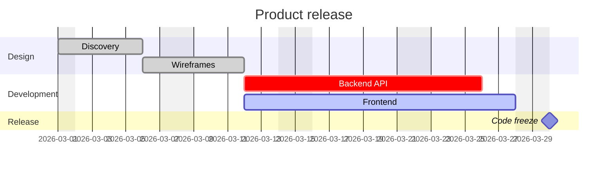

# Диаграмма Ганта



## Настройки

Настройки действуют на всю диаграмму, где бы они ни стояли.

| Настройка | Значение |
|---|---|
| `title …` | заголовок над диаграммой |
| `dateFormat …` | формат дат в задачах (по умолчанию `YYYY-MM-DD`) |
| `axisFormat …` | формат дат на оси (strftime) |
| `tickInterval 1day` | шаг оси: число и `millisecond`, `second`, `minute`, `hour`, `day`, `week` или `month` |
| `excludes …` | нерабочие дни: `weekends`, названия дней недели, даты — через запятую или пробел |
| `includes …` | даты, которые учитываются, даже если исключены |
| `weekend friday` / `weekend saturday` | какие два дня означает `weekends` (по умолчанию суббота и воскресенье) |
| `inclusiveEndDates` | дата окончания включает этот день |
| `todayMarker off` | см. «Сегодня» ниже |
| `topAxis` | ось ещё и сверху |
| `section …` | начинает группу задач |

**Токены `dateFormat`:** `YYYY`, `YY`, `MM`, `M`, `DD`, `D`, `HH`, `H`,
`mm`, `m`, `ss`, `s`, `SSS`, `X` (секунды Unix), `x` (миллисекунды Unix)
и буквальный текст в квадратных скобках (`[brackets]`). Токены, обозначающие названия, —
названия месяцев и дней недели, порядковые числительные, AM/PM, часовые
пояса — считаются ошибкой, а не угадываются. Даты читаются в UTC, поэтому
диаграмма не зависит от часового пояса читателя; дата, не соответствующая
формату, — ошибка (Mermaid в этом случае переходит к разбору дат браузером,
который от пояса зависит).

**Директивы `axisFormat`:** `%Y %y %m %d %e %j %b %B %a %A %u %w %H %I %M
%S %L %p %%`. Без `axisFormat` формат следует шагу делений: часы и минуты
для шагов меньше суток, месяц и год для помесячных, иначе дата.

## Задачи

```
Task name : [tags,] [id,] [start,] end-or-duration
```

- **Теги** в любом сочетании: `done`, `active`, `crit`, `milestone`.
- **Id**: слово без пробелов, на которое ссылается `after`.
- **Начало**: дата в формате `dateFormat` или `after id1 id2 …` — самое
  позднее окончание этих задач (они могут быть определены ниже в исходном
  тексте). Без начала задача стартует, когда заканчивается предыдущая; первой
  задаче начало нужно.
- **Окончание**: дата, `until id` (когда начинается та задача) или
  длительность: число с `ms`, `s`, `m`, `h`, `d`, `w` (например, `3d`,
  `1.5h`, `2w`).

Задача, заданная длительностью, растягивается на исключённые дни, как в
Mermaid; задача с датой окончания заканчивается в эту дату. Веха рисуется
ромбом в точке своего начала.

Задачи без id получают `task1`, `task2`, … по своему положению на диаграмме.

## Ссылки

`click id href "https://…"` делает задачу ссылкой (только `http(s)`,
`mailto`, относительные).

## Сегодня

Линия текущей даты сделала бы результат зависимым от часов, поэтому `render`
рисует её только по запросу и с указанной датой:

```ts
render(source, { today: new Date() })
```

Линия появляется, если эта дата попадает в диапазон диаграммы.
`todayMarker off` в исходном тексте отключает её и в этом случае.

## Не поддерживается

- `displayMode compact` — каждая задача занимает свою строку.
- `click id call …` — ничто из текста диаграммы не выполняется.
- Маркеры `vert`.
- Токены `dateFormat`, обозначающие названия, strftime `%U %W %Z %q`.
