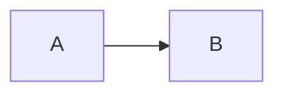

# Начало работы

## Установка

```bash
npm install @dskripchenko/diagrams
```

Пакет — ES-модуль со сборкой CommonJS рядом и собственными определениями
типов. Зависимостей у него нет.

## Отрисовка диаграммы

```ts
import { render } from '@dskripchenko/diagrams'

const result = render(`sequenceDiagram
  Alice->>Bob: Hello
  Bob-->>Alice: Hi`)

result.svg     // '<svg xmlns="http://www.w3.org/2000/svg" …>…</svg>'
result.width   // natural size in pixels
result.height
result.type    // 'sequence'
```

SVG несёт собственные `width`, `height` и `viewBox`, а также стиль
`max-width:100%;height:auto`, поэтому сжимается под узкий контейнер и
никогда не становится больше своего естественного размера. Вставьте его на
страницу как разметку:

```ts
container.innerHTML = result.svg
```

Тип определяется по первой строке: `flowchart` или `graph`,
`sequenceDiagram`, `stateDiagram-v2` (или `stateDiagram`), `pie`, `gantt`,
`C4Context`, `C4Container`, `C4Component`, `C4Dynamic`, `C4Deployment`.

## Параметры

```ts
render(source, {
  measureText,  // how text is measured — see below
  idPrefix,     // prefix for ids inside the SVG
  title,        // accessible title
  today,        // gantt: draw a "today" line at this date
})
```

**`idPrefix`.** Каждый id внутри SVG — корень, маркеры стрелок, локальная
таблица стилей — начинается с этого префикса. По умолчанию это хеш исходного
текста, так что одна и та же диаграмма всегда получает одинаковые id. Если
**одна и та же** диаграмма показана на странице дважды, задайте каждой копии
свой префикс.

**`title`.** У SVG есть `role="img"` и `<title>` для экранных дикторов.
Заголовок берётся из этого параметра, затем из `accTitle:` в исходном тексте,
затем из собственного заголовка диаграммы, затем из её типа. `accDescr:`
становится элементом `<desc>`.

## Измерение текста

Раскладка зависит от ширины каждой подписи, а та — от шрифта, который
использует браузер читателя. Поэтому измерение — это функция, которую можно
заменить:

- **В браузере** по умолчанию текст измеряется через canvas (`OffscreenCanvas`,
  где он доступен) тем же набором шрифтов, который запрашивает SVG.
- **Без DOM** — серверная отрисовка, скрипты Node, тесты — по умолчанию
  используется `approximateMeasurer`: таблица ширин символов для латиницы,
  кириллицы, цифр и знаков препинания, иероглифы CJK — полной ширины. Фигуры
  получают запас, чтобы небольшая погрешность не приводила к выходу текста
  за границы.

```ts
import { render, approximateMeasurer } from '@dskripchenko/diagrams'

// Identical output in every environment: use this for snapshots and caches.
render(source, { measureText: approximateMeasurer })
```

Собственная функция измерения получает текст и шрифт (`size`, `family`,
`weight`, `style`) и возвращает `{ width, height }` в пикселях.

## Ошибки

Исходный текст, который не удаётся разобрать, вызывает `DiagramError`:

```ts
import { render, DiagramError } from '@dskripchenko/diagrams'

try {
  render(source)
} catch (error) {
  if (error instanceof DiagramError) {
    error.line     // 1-based, 0 when the problem is the diagram as a whole
    error.column   // 1-based, 0 when unknown
    error.hint     // what to write instead, when there is an obvious answer
    error.message  // includes the position
  }
}
```

Поддерживается заявленное подмножество синтаксиса Mermaid, описанное для
каждого типа в этой документации. Всё, что за его пределами, — ошибка с
указанием позиции, а не картинка, в которой что-то молча пропущено.

## Другие функции

```ts
import { detect, parse } from '@dskripchenko/diagrams'

detect('pie\n "a" : 1')   // 'pie' — or null when the first line names no known type
parse(source)             // the parsed structure, without layout: for tools and tests
```

## В отрисовщике Markdown

Обычный способ встраивания — блок кода с ограждением:

````markdown

````

Передайте текст блока в `render` и поставьте SVG на место кода; при
`DiagramError` покажите вместо него код и сообщение. В
[`@dskripchenko/ui`](https://github.com/dskripchenko/ui) компонент `UidMarkdown`
принимает отрисовщики блоков ровно для этого:

```ts
import { render, DiagramError } from '@dskripchenko/diagrams'

const mermaid = (code: string) => {
  try {
    return { html: render(code).svg }
  } catch (error) {
    if (error instanceof DiagramError) return { error: error.message }
    throw error
  }
}
// <UidMarkdown :source="text" :block-renderers="{ mermaid }" />
```

SVG безопасно вставлять как разметку: весь текст в нём экранирован пакетом.

## Ограничения

Блок-схема или диаграмма состояний может содержать до 500 узлов и 2000 рёбер;
сверх этого время раскладки перестаёт быть предсказуемым, и отрисовка
вызывает `DiagramError` с предложением разбить диаграмму. 500 узлов
раскладываются заметно быстрее чем за секунду.
