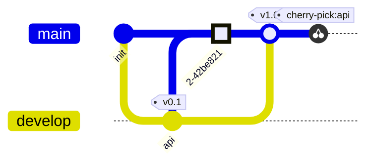

# Git-граф



Коммиты в порядке записи, у каждой ветки своя дорожка; `main` есть с
самого начала.

| Синтаксис | |
|---|---|
| `gitGraph`, `gitGraph TB:`, `gitGraph BT:` | слева направо, сверху вниз, снизу вверх |
| `commit` | коммит в текущей ветке |
| `… id: "x" msg: "…" tag: "v1" type: NORMAL\|REVERSE\|HIGHLIGHT` | его id (показывается), сообщение (показывается, если нет id), тег, вид |
| `branch имя`, `… order: 2` | новая ветка от текущего коммита, становится текущей; `order` задаёт место дорожки |
| `checkout имя`, `switch имя` | текущая ветка |
| `merge имя`, с параметрами коммита | коммит слияния с двумя родителями |
| `cherry-pick id: "x"` | копия коммита x в текущей ветке |

Ошибки: неизвестная ветка, слияние без нового, повторный id коммита. До 500
коммитов.

## Граф коммитов рядом со списком

Для настоящей истории — коммиты из репозитория, новые сверху — граф рисуется
отдельной колонкой, выровненной по списку, который рисует сама программа
(сообщения, авторы, даты): по полосе на линию разработки, по строке на коммит,
изгибы на ответвлениях и слияниях.

```ts
import { renderCommitGraph } from '@dskripchenko/diagrams'

const { svg, width, graph } = renderCommitGraph(
  [
    { id: 'm', parents: ['b', 'f'] }, // слияние
    { id: 'f', parents: ['a'] },
    { id: 'b', parents: ['a'] },
    { id: 'a', parents: [] },
  ],
  { rowHeight: 28, head: 'm' },
)
```

Центр строки *k* — `k × rowHeight + rowHeight / 2`, поэтому колонка встаёт
рядом со строками списка такой высоты. Коммит занимает полосу, которая его
ждёт; первый родитель продолжает полосу, остальные получают свои; ветка идёт
рядом с основой до общего коммита и там возвращается в неё. Коммиты слияния —
кольца, `head` обведён, у каждой полосы свой цвет палитры (`--dg-pie-1` …
`--dg-pie-12`). Родитель, которого нет в списке (история обрезана), оставляет
линию до низа колонки.

| Параметр | По умолчанию | |
|---|---|---|
| `rowHeight` | 28 | высота строки списка |
| `laneWidth` | 14 | расстояние между полосами |
| `radius` | 4 | точка коммита |
| `head` | — | текущий коммит, отмечается |
| `id` | `dg-commits` | id `<svg>`, ограничивает его стили |
| `title` | Commit graph | для вспомогательных технологий |

В результате — `width` и `height`, `graph` (раскладка: строки с полосой и
цветом, отрезки линий) и `laneX(lane)`, чтобы размещать что-то рядом.
`layoutCommitGraph(commits)` даёт одну раскладку — для программы, которая
рисует сама.
