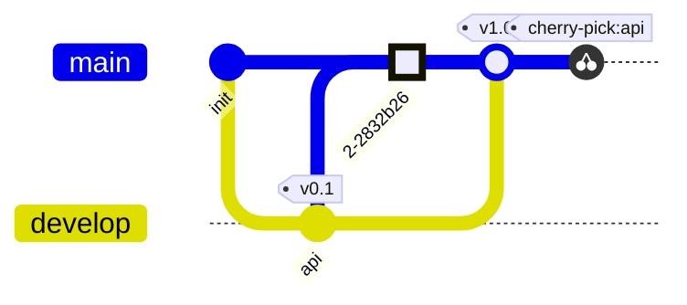

# Git-граф

Коммиты в порядке записи, у каждой ветки своя дорожка; `main` есть с
самого начала.

| Синтаксис | |
|---|---|
| `gitGraph`, `gitGraph TB:`, `gitGraph BT:` | слева направо, сверху вниз, снизу вверх |
| `commit` | коммит в текущей ветке |
| `… id: "x" msg: "…" tag: "v1" type: NORMAL\|REVERSE\|HIGHLIGHT` | его id (показывается), сообщение (показывается, если нет id), тег, вид |
| `branch имя`, `… order: 2` | новая ветка от текущего коммита, становится текущей; `order` задаёт место дорожки |
| `checkout имя`, `switch имя` | текущая ветка |
| `merge имя`, с параметрами коммита | коммит слияния с двумя родителями |
| `cherry-pick id: "x"` | копия коммита x в текущей ветке |

Ошибки: неизвестная ветка, слияние без нового, повторный id коммита. До 500
коммитов.
