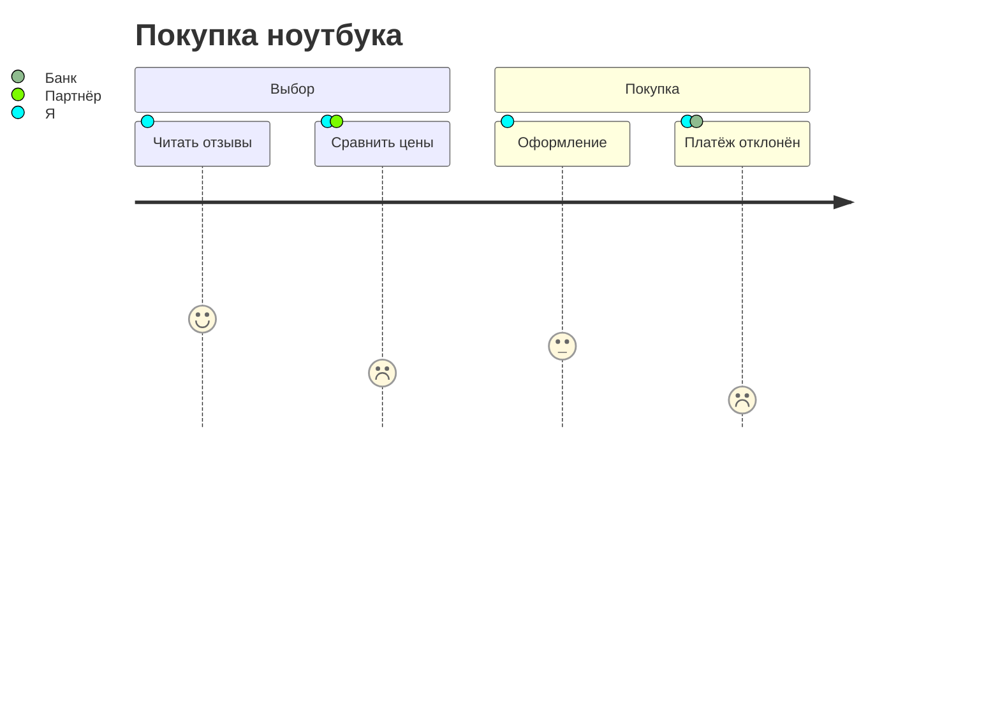

# Путь пользователя

Карта пути клиента (CJM): шаги слева направо под своими разделами. У
каждого шага оценка от 1 (плохо) до 5 (хорошо) — лицо, которое стоит тем
выше, чем лучше оценка, — и участники: цветные точки, расшифрованные в
легенде слева.

| Синтаксис | |
|---|---|
| `title …` | заголовок |
| `section …` | начинает группу шагов |
| `Шаг: 5: Участник, Другой` | шаг, его оценка (1–5) и участники (необязательно) |

Переменные темы: `--dg-journey-face`, `--dg-journey-face-sad` (оценки 1–2),
`--dg-journey-face-happy` (4–5); цвета разделов берутся из палитры
(`--dg-pie-1` …).
