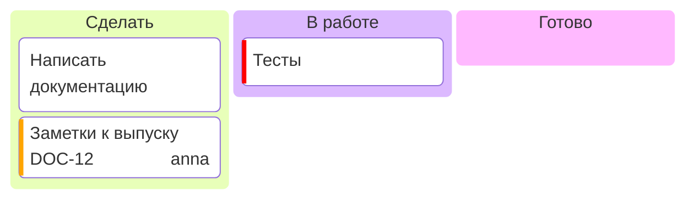

# Канбан-доска

| Синтаксис | |
|---|---|
| `id[Название]` на внешнем отступе | колонка |
| `id[Текст]`, `[Текст]` или текст с отступом под колонкой | карточка |
| `@{ assigned: 'имя', ticket: KEY-1, priority: 'High' }` | данные карточки; приоритет — `Very High`, `High`, `Low` или `Very Low` (цветная полоса) |

Колонки стоят рядом и тянутся до высоты самой высокой.
