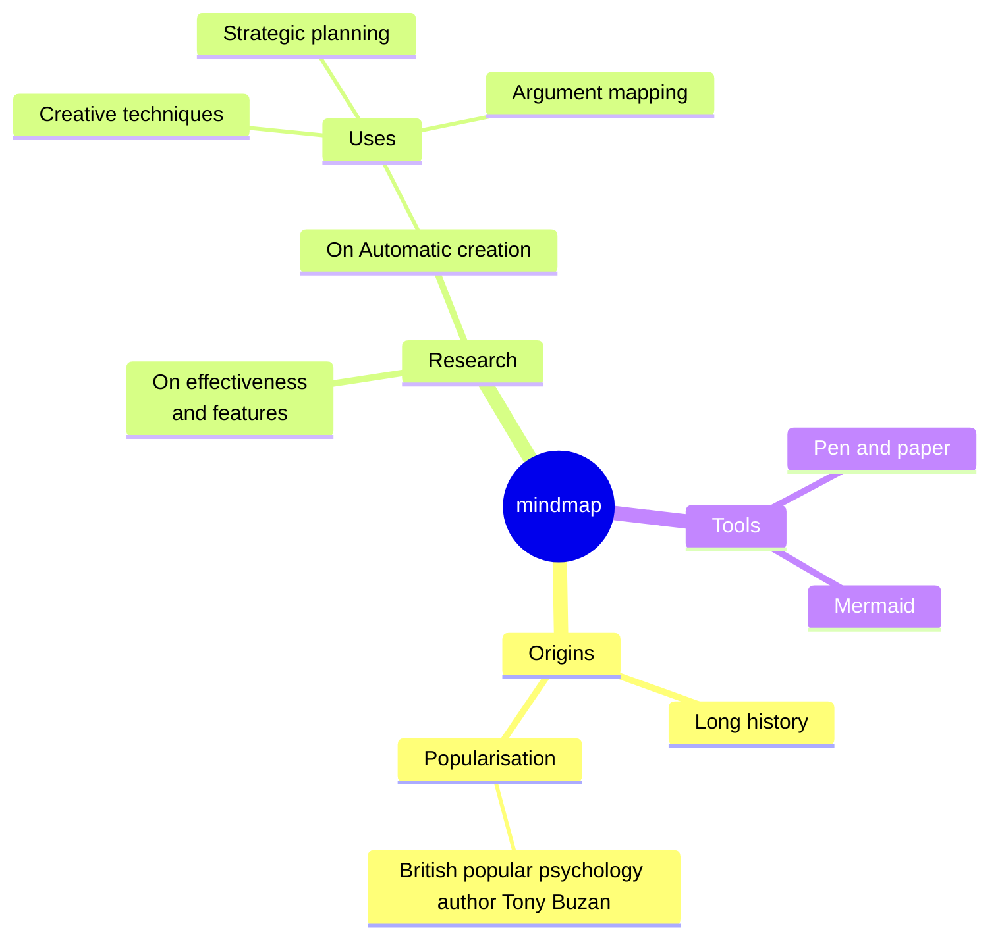

# Интеллект-карта



`mindmap` в первой строке, затем план: по узлу в строке, вложенность —
отступами.

## Структура

- **Первый узел — корень.** Корень один: следующий узел с таким же (или
  меньшим) отступом, как у корня, — ошибка, в которой назван корень.
- **Родитель узла** — ближайший узел выше с меньшим отступом. Отступы не
  обязаны быть ровными — `4`, затем `6`, затем `5` пробелов работают, как в
  Mermaid. Каждый пробельный символ считается за одну колонку, табуляция
  тоже, поэтому не смешивайте табуляции и пробелы.
- `%%` начинает комментарий. `accTitle:` / `accDescr:` задают заголовок и
  описание для специальных возможностей.

## Формы узлов

| Исходник | Форма |
|---|---|
| `Text` | по умолчанию: подкрашенный блок, подчёркнутый цветом ветви |
| `id[Text]` | прямоугольник |
| `id(Text)` | скруглённый |
| `id((Text))` | круг |
| `id))Text((` | взрыв (bang) |
| `id)Text(` | облако |
| `id{{Text}}` | шестиугольник |

- Id перед формой необязателен: `[Text]` тоже работает.
- Текст узла без формы — вся строка. Скобка в нём начинает форму, как в
  Mermaid: `Pen (and) paper` — ошибка (форма `(` не закрыта в конце строки).
  Такой текст берите в кавычки: `id["Pen (and) paper"]` или
  `"Pen (and) paper"` для формы по умолчанию.
- Корень без формы рисуется скруглённым блоком.

## Подписи

- `<br>` переносит строку. Подписи шире 200 пикселей переносятся.
- **Markdown-строки** — ``id["`text`"]`` — понимают `**жирный**` и
  `*курсив*` и могут занимать несколько строк исходника; каждая строка
  внутри — строка подписи:

  ```
  mindmap
      id1["`**Root** with
  a second line`"]
  ```

- Вне markdown-строк `*` и `_` — обычные символы.

## Иконки и классы

`::icon(fa fa-book)` на строке под узлом (или в конце его строки) и
`:::имена классов` принимаются и сохраняются в разобранном дереве, но **не
рисуются**: иконке нужен иконочный шрифт, на который SVG не может
рассчитывать, а у интеллект-карт Mermaid нет `classDef`, который придал бы
классу смысл. Поэтому диаграмма, написанная для Mermaid, рисуется без
изменений — просто без иконок.

## Раскладка

Корень — в центре. Его ветви делятся между правой и левой стороной так,
чтобы стороны были примерно одной высоты; читаются они по часовой стрелке —
первые ветви идут вниз по правой стороне, остальные поднимаются по левой.
Каждая ветвь растёт наружу аккуратным деревом: дети друг под другом, родитель
по центру своих детей.

Раскладка детерминирована — без силовой симуляции и случайности, — поэтому
один и тот же исходник всегда даёт одну и ту же картинку. Собственная
раскладка Mermaid другая (силовая); структура та же.

Каждая ветвь первого уровня берёт цвет из `--dg-pie-1` … `--dg-pie-12` — для
своих узлов (подкрашенных) и соединительных линий (сплошных); корень
использует `--dg-node-fill`, `--dg-node-stroke` и `--dg-node-text`. См.
[оформление](theming.md).

В интеллект-карте может быть до 500 узлов.
