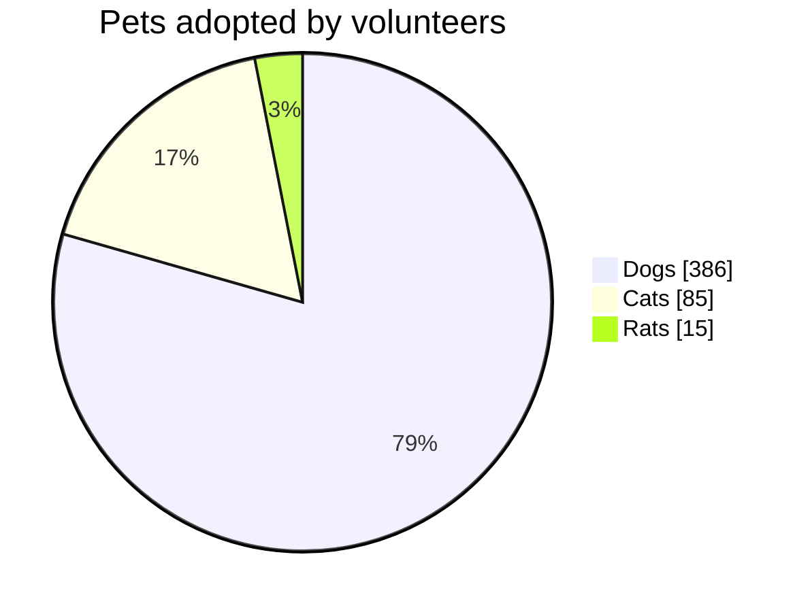

# Круговая диаграмма

- `pie`, за которым на той же строке могут следовать `showData` и/или
  `title …`.
- `title …` и `showData` также могут быть отдельными строками.
- Каждый сектор: подпись в двойных (или одинарных) кавычках, двоеточие,
  число. Отрицательные числа — ошибка; нулевые секторы перечисляются в
  легенде, но не рисуются.
- `accTitle:` / `accDescr:` задают заголовок и описание для специальных
  возможностей.

Секторы рисуются **в порядке записи**, по часовой стрелке от двенадцати
часов, поэтому порядок на диаграмме совпадает с легендой и исходным текстом.
Проценты выводятся внутри секторов от 3% и больше. `showData` добавляет
значение к каждому пункту легенды.

Цвета секторов — `--dg-pie-1` … `--dg-pie-12` (по кругу); см.
[оформление](theming.md).
