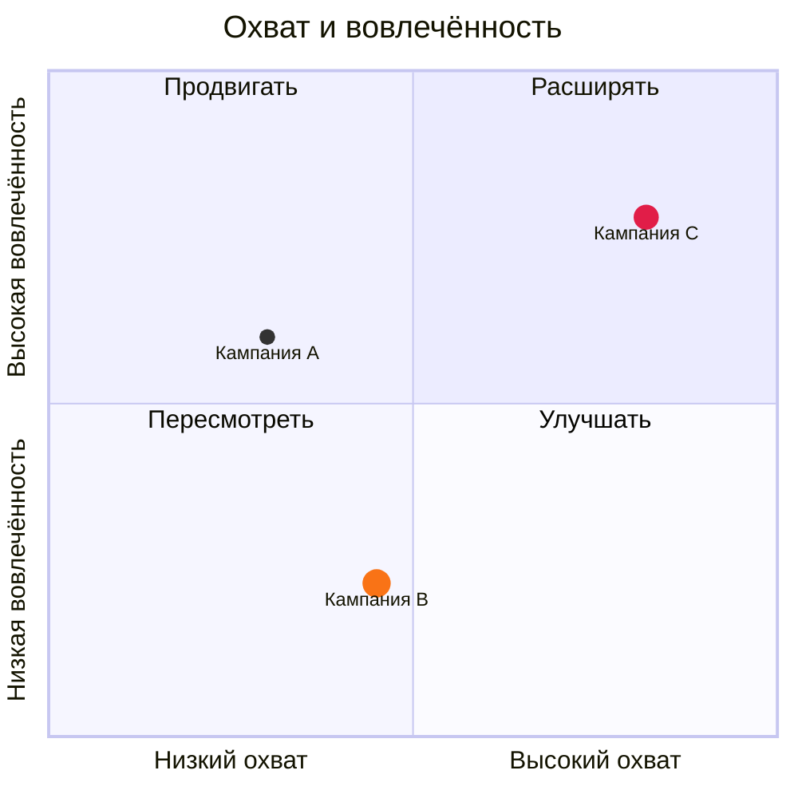

# Квадрантная диаграмма

| Синтаксис | |
|---|---|
| `title …` | заголовок |
| `x-axis Мало --> Много`, `y-axis Мало --> Много` | подписи осей с двух концов или одна посередине |
| `quadrant-1 …` … `quadrant-4 …` | подписи квадрантов: 1 — справа вверху, 2 — слева вверху, 3 — слева внизу, 4 — справа внизу |
| `Имя: [x, y]` | точка, обе координаты от 0 до 1 |
| `… radius: 9, color: #f97316, stroke-color: #fff, stroke-width: 2px` | стиль точки |
| `Имя:::класс: [x, y]`, `classDef класс color: …, radius: …` | общий стиль |

Переменные темы: `--dg-quadrant-1` … `--dg-quadrant-4`.
