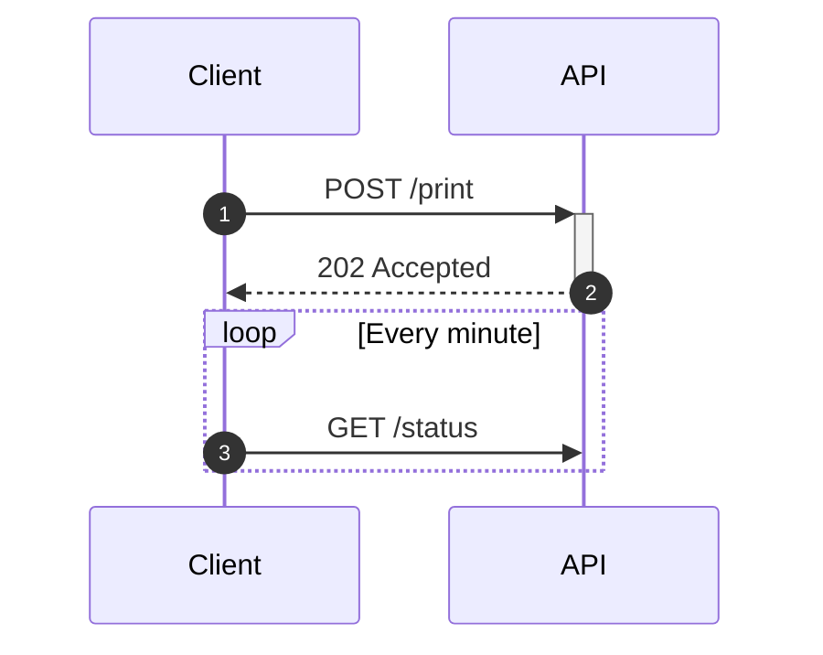

# Диаграмма последовательности



## Участники

| Синтаксис | Значение |
|---|---|
| `participant A` | прямоугольник с именем `A` |
| `participant A as Alice` | id `A`, отображается как «Alice» |
| `actor A` | человечек вместо прямоугольника |
| (неявно) | имя, использованное в сообщении, становится участником |

Участники располагаются слева направо в порядке объявления или первого
использования. `<br>` переносит строку подписи.

**Группы** объединяют участников на общем фоне:

```
box Lavender Backend
    participant A as API
    participant W as Worker
end
```

Цвет (название, `#hex`, `rgb()` …) и подпись необязательны. Внутри группы
допустимы только объявления участников; группы не вкладываются.

**Создание и удаление.** `create participant B` перед сообщением, в котором
впервые участвует `B`, рисует `B` в этом месте, а не наверху. `destroy B`
завершает линию жизни `B` крестиком у следующего сообщения с его участием.

## Сообщения

`A->>B: text`. Стрелки:

| Стрелка | Линия | Наконечник |
|---|---|---|
| `->` | сплошная | нет |
| `-->` | пунктирная | нет |
| `->>` | сплошная | стрелка |
| `-->>` | пунктирная | стрелка |
| `-x` | сплошная | крестик |
| `--x` | пунктирная | крестик |
| `-)` | сплошная | открытый (асинхронно) |
| `--)` | пунктирная | открытый (асинхронно) |
| `<<->>` | сплошная | стрелки на обоих концах |
| `<<-->>` | пунктирная | стрелки на обоих концах |

Сообщение участника самому себе рисуется петлёй справа.

**Активации.** `A->>+B: text` активирует `B`; `B-->>-A: text` завершает
активацию `B`. `activate B` и `deactivate B` делают то же отдельными
строками. Активации вкладываются и рисуются со смещением. Деактивация
неактивного участника — ошибка.

**Нумерация.** `autonumber` нумерует последующие сообщения;
`autonumber 10`, `autonumber 10 5` задают начало и шаг;
`autonumber off` останавливает нумерацию.

## Заметки

```
Note right of A: text
Note left of A: text
Note over A: text
Note over A,B: spans both
```

Длинные заметки переносятся.

## Блоки

```
loop Every minute
    …
end

alt Success
    …
else Failure
    …
end

opt Optional
    …
end

par Alice to Bob
    …
and Alice to John
    …
end

critical Establish a connection
    …
option Timeout
    …
end

break When the request fails
    …
end

rect rgb(200, 220, 255)
    …
end
```

Блоки вкладываются. `else`, `and` и `option` вне своего блока — ошибка, как
и `end` без открытого блока или незакрытый блок. `rect` принимает цвет и
рисует фон под своими сообщениями.

## Прочее

`title …`, `accTitle:`, `accDescr:`, комментарии `%%`.

## Не поддерживается

- Метаданные `participant A@{ … }` (Mermaid 11) — ошибка.
- `link`, `links`, `properties`, `details` — им нужны всплывающие меню,
  которых у статичного SVG нет.
- Группа внутри блока или вложенные группы (Mermaid их тоже не допускает).
