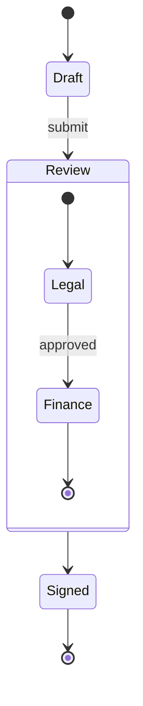

# Диаграмма состояний



## Заголовок

`stateDiagram-v2` или `stateDiagram` — синтаксис одинаковый. `direction
TB|BT|LR|RL` отдельной строкой задаёт направление (по умолчанию сверху вниз).

## Состояния

| Синтаксис | Значение |
|---|---|
| `Moving` | состояние, названное по его id |
| `state "Long name" as s1` | состояние с отображаемым именем |
| `s1 : description` | строка описания; повторите для нескольких строк |
| `state s1 : description` | то же самое |
| `[*]` | начало (как источник) или конец (как цель) |

Состояние с описанием рисуется с именем сверху, разделительной линией и
строками описания под ней.

## Переходы

`A --> B` и `A --> B : event`. `[*] --> A` — начало, `A --> [*]` — конец.

## Составные состояния

```
state Review {
    [*] --> Legal
    Legal --> [*]
}
```

`state Name {` … `}` (или `state "Title" as Name {`) вкладывает состояния;
составные состояния вкладываются и дальше. `[*]` внутри составного
состояния — его собственные начало и конец. Переходы могут указывать на
составное состояние; они заканчиваются на его рамке. `direction` внутри
составного состояния задаёт его собственное направление, если ни одно
состояние внутри не связано с состоянием снаружи (как в Mermaid).

**Параллельные области.** `--` отдельной строкой внутри составного состояния
делит его на области, которые рисуются рядом в пунктирных рамках:

```
state Active {
    [*] --> NumLockOff
    NumLockOff --> NumLockOn : press
    --
    [*] --> CapsLockOff
    CapsLockOff --> CapsLockOn : press
}
```

## Псевдосостояния

```
state check <<choice>>
state split <<fork>>
state merge <<join>>
```

Выбор — маленький ромб; разветвление и слияние — полосы поперёк потока.

## Заметки

```
note right of Draft : Edited by the author
note left of Review
    Two lines
    of text
end note
```

При раскладке сверху вниз заметки располагаются слева или справа от своего
состояния; при раскладке слева направо — где «слева» поставило бы заметку на
входящий переход — `left of` помещает её сверху, а `right of` — снизу.
Заметка к составному состоянию соединяется с его рамкой.

## Стили

`classDef`, `class a,b name`, `state:::name` и `style id …` работают так же,
как в [блок-схемах](flowchart.md#стили-и-классы), с теми же проверяемыми
свойствами.

## Не поддерживается

- `click` на состояниях.
- Строки Markdown в именах состояний.
