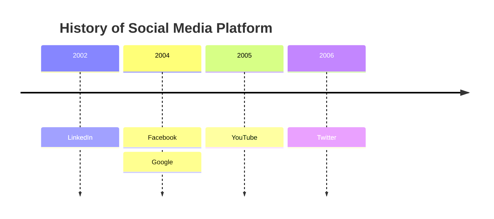
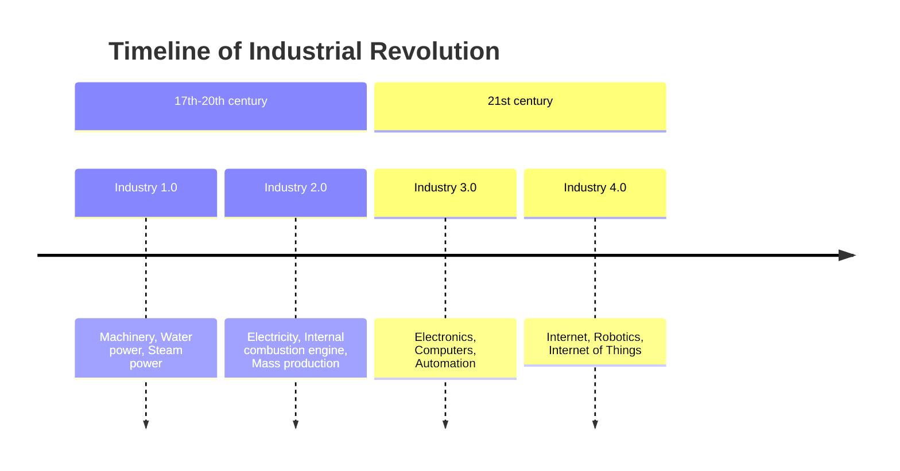

# Временная шкала

- `timeline` в первой строке. `timeline LR` принимается как то же самое;
  `timeline TD` (вертикальная шкала) — ошибка.
- `title …` — заголовок над шкалой.
- **Период** — отдельная строка: текст периода, затем его события, каждое
  после `: `. `2004 : Facebook : Google` — период с двумя событиями. У периода
  может не быть событий вовсе.
- **Строка, начинающаяся с `:`**, добавляет события к периоду над ней, так
  длинный список можно писать по событию в строке.
- Разделитель — двоеточие, **за которым идёт пробел** (или конец строки).
  Двоеточие внутри слова остаётся текстом: `10:30 : Stand-up at 10:30` — это
  период `10:30` с событием `Stand-up at 10:30`.
- `section …` начинает группу: периоды после него, до следующего раздела,
  принадлежат ему. Периоды до первого раздела не принадлежат ни одному.
- ` ` переносит строку в любом тексте; длинный текст переносится по
  ширине колонки.
- `%%` начинает комментарий. `accTitle:` / `accDescr:` задают заголовок и
  описание для специальных возможностей.

Пустое событие (`2024 : a :  : b`), события до первого периода и раздел без
названия — ошибки с номером строки и колонки.

## Разделы

Каждый раздел — заголовок над своими периодами. Раздел без периодов всё
равно получает заголовок шириной в одну колонку, так что ничего написанное
не теряется.

## Отрисовка

Периоды стоят над горизонтальной стрелкой, по колонке на каждый, слева
направо в порядке записи; события периода сложены стопкой под стрелкой и
соединены с ней пунктиром. У колонок постоянная ширина, поэтому периоды
выровнены независимо от длины текста.

Цвета — как в Mermaid. **Без разделов** у каждого периода свой цвет: период
залит им целиком, его события — тем же цветом, но бледнее. **С разделами**
цвет принадлежит разделу: заголовок залит, его периоды и события — бледнее.
Цвета берутся по порядку из `--dg-pie-1` … `--dg-pie-12`, текст на залитых
блоках — `--dg-pie-text`; см. [оформление](theming.md).

Не поддерживаются: настройка Mermaid `disableMulticolor` и вертикальные
шкалы. Ограничения: до 200 периодов и 1000 событий.
