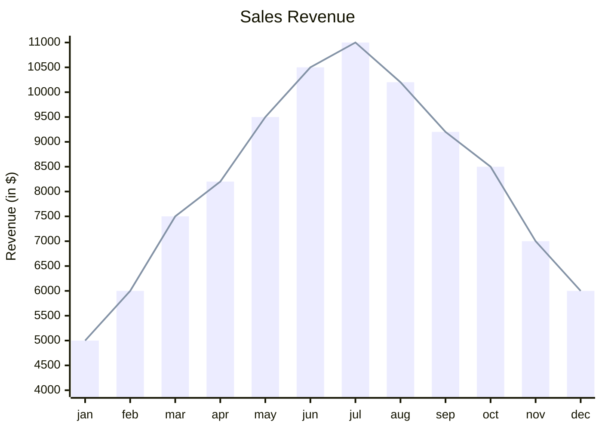

# XY-график

Первая строка — `xychart-beta` (название в Mermaid) или `xychart`, за ним
может идти `horizontal` (или `vertical`, по умолчанию).

## Инструкции

| Инструкция | Значение |
|---|---|
| `title "Текст"` | заголовок над графиком; кавычки необязательны |
| `x-axis [a, b, "c d"]` | категориальная ось x: по категории на точку |
| `x-axis "Заголовок" [a, b]` | то же с заголовком оси |
| `x-axis "Заголовок" 0 --> 100` | числовая ось x: точки равномерно распределены от 0 до 100 |
| `x-axis "Заголовок"` | только заголовок: точки нумеруются 1, 2, 3 … |
| `y-axis "Заголовок" 0 --> 100` | ось значений с диапазоном |
| `y-axis "Заголовок"` / `y-axis 0 --> 100` | только заголовок или только диапазон |
| `bar [1, 2, 3]` | серия столбцов |
| `line [1, 2, 3]` | серия-линия |
| `bar "Имя" [1, 2, 3]` | именованная серия: именованные серии перечислены в легенде |

- **Заголовки** — в двойных кавычках или словами без кавычек:
  `x-axis Months [jan, feb]`. Markdown-строка ``"`text`"`` читается как
  обычный текст.
- **Категории** разделяются запятыми; категория с запятой или пробелами по
  краям берётся в двойные кавычки. ` ` переносит подпись категории.
- **Значения** — обычные числа: `12`, `-3.5`, `.25`, `1e3`. Отрицательные
  значения рисуются вниз от нуля.
- Серий сколько угодно, столбцы и линии вперемешку. Столбцы нескольких серий
  стоят рядом внутри своей категории; линии рисуются поверх столбцов.
- Без `x-axis` точки нумеруются с 1.
- `%%` начинает комментарий. `accTitle:` / `accDescr:` задают заголовок и
  описание для специальных возможностей.

**У каждой серии по одному значению на точку**: столько значений, сколько
категорий, а на числовой или отсутствующей оси x — сколько у первой серии.
Mermaid молча отбрасывает лишние значения и оставляет пропуски пустыми; здесь
несовпадение — ошибка на строке серии, так что на графике никогда не бывает
меньше точек, чем написано. Неверные числа, диапазон, конец которого не больше
начала, ось, объявленная дважды, и неизвестные инструкции — ошибки с номером
строки и колонки.

## Оси

**Ось значений** использует написанный диапазон как есть. Без него диапазон
берётся из данных и расширяется до целых шагов делений — а если есть
столбцы, он всегда включает ноль, потому что столбец не от нуля искажает
значение. (Mermaid начинает столбцы от наименьшего значения.) Значения за
пределами написанного диапазона обрезаются по краю области графика.

**Деления** приходятся на 1, 2, 2,5 или 5, умноженные на степень десяти,
примерно каждые 45 пикселей на вертикальной оси. Подписи на одной оси
оформлены одинаково: столько знаков после точки, сколько нужно шагу,
настоящий знак минуса, а начиная с десяти тысяч — единица измерения: `15k`,
`2.5M`, `1B`, `1T`.

**Подписи категорий**, которые не помещаются в свою полосу, на вертикальном
графике наклоняются на 45 градусов; на горизонтальном — выравниваются по
правому краю и переносятся.

## Горизонтальные графики

```mermaid
xychart-beta horizontal
    title "Time to first byte by region"
    x-axis Region ["North America", "Western Europe", "South-East Asia", Oceania]
    y-axis "Milliseconds"
    bar "p50" [82, 95, 210, 230]
    bar "p95" [190, 220, 480, 520]
```

Как и в Mermaid, `x-axis` по-прежнему задаёт категории, а `y-axis` —
значения; `horizontal` только поворачивает картинку: категории идут сверху
вниз по левой стороне, значения — вдоль нижнего края.

## Цвета

Серии берут цвета по порядку из `--dg-pie-1` … `--dg-pie-12` — той же
палитры, что у круговых диаграмм. Сетка — `--dg-grid`, линия оси —
`--dg-line`, подписи делений — `--dg-text-muted`; см.
[оформление](theming.md).

Не поддерживается: конфигурация графика Mermaid (ширина, высота, подписи
данных, своя палитра в `%%{init}%%`) — директивы игнорируются, как и для
любого типа диаграмм.
