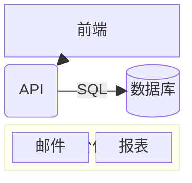

# 块图

在网格上手动放置的块——与自动布局的流程图不同。

| 语法 | |
|---|---|
| `columns 3` | 列数；没有时全部放在一行 |
| `a b c` | 块，从左到右填满各行 |
| `id:2` | 占两列宽的块 |
| `space`、`space:2` | 空单元格 |
| `a["文本"]`、`a("…")`、`a(("…"))`、`a[("…")]`、`a{"…"}`、`a{{"…"}}`、`a>"…"]`、`a[/"…"/]` … | [流程图](flowchart.md)的形状 |
| `block:id["标题"]:3` … `end` | 嵌套网格，有自己的 `columns` |
| `a --> b`、`a --- b`、`a -.-> b`、`a ==> b`、`a -- "文本" --> b` | 连线，在块或分组之间直线绘制 |
| `style a fill:…`、`classDef`、`class a 名称`、`a:::名称` | 样式 |
