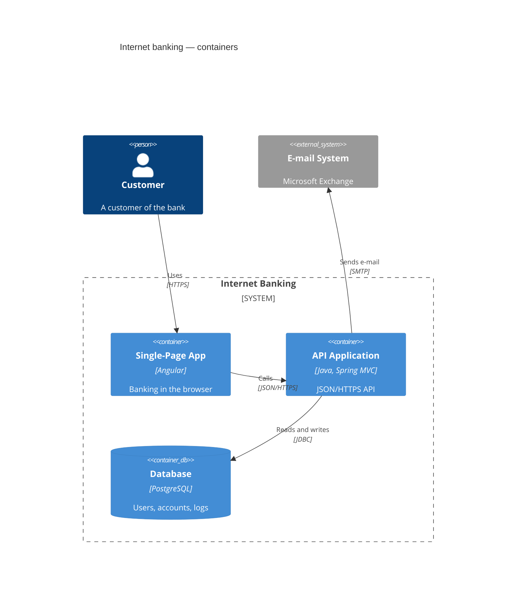

# C4 图



使用 Mermaid 语法的 [C4 模型](https://c4model.com)，该语法沿用 C4-PlantUML：
每条语句都是一个宏调用。图以经典的 C4 外观绘制——人员、从系统到组件逐级变浅的
蓝色方框、灰色的外部元素、虚线边界。

## 头部

`C4Context`、`C4Container`、`C4Component`、`C4Dynamic`、`C4Deployment`
之一。它们共用一套语法；关键字只影响哪些内容会被编号（见
[C4Dynamic](#c4dynamic)）。单独一行的 `title …` 在图上方显示标题，并作为其
无障碍名称；`accTitle:` 和 `accDescr:` 与其他图相同。注释以 `%%` 开头。

## 参数

参数可以按位置或按名称传递，也可以混用：

```
Container(api, "API", "Go", "Serves the shop")
Container(api, "API", $techn="Go", $descr="Serves the shop")
```

值可以加引号（`"…"`，含逗号或括号时必须加）或不加。`<br>` 和 C4-PlantUML 的
`\n` 表示换行；较长的文本会自动换行。`$sprite`、`$tags`、`$link` 和
`$baseShape` 会被接受并忽略——不绘制图标、标签或链接。宏不具有的命名参数会报错，
因此拼写错误会被指出，而不是被悄悄丢弃。

## 元素

| 宏 | 参数 |
|---|---|
| `Person`、`Person_Ext` | alias, label, ?descr, ?sprite, ?tags, ?link |
| `System`、`SystemDb`、`SystemQueue`（+ `_Ext`） | alias, label, ?descr, ?sprite, ?tags, ?link |
| `Container`、`ContainerDb`、`ContainerQueue`（+ `_Ext`） | alias, label, ?techn, ?descr, ?sprite, ?tags, ?link |
| `Component`、`ComponentDb`、`ComponentQueue`（+ `_Ext`） | alias, label, ?techn, ?descr, ?sprite, ?tags, ?link |

每个元素以粗体显示名称，随后是类型行——`[Person]`、`[Software System]`、
`[Container: 技术]`、`[Component: 技术]`，`_Ext` 元素前面加 `External`——
以及描述。人员或系统上的 `$type="…"` 会替换类型行。`…Db` 元素绘制为圆柱体，
`…Queue` 元素绘制为横放的管道。别名（alias）必须唯一。

## 边界

```
Enterprise_Boundary(corp, "Big Bank plc") {
    System_Boundary(bank, "Internet Banking") {
        Container(api, "API", "Java")
    }
    Boundary(team, "Payments team", "squad") {
        Component(pay, "Payments", "Spring Bean")
    }
}
```

| 宏 | 参数 | 类型行 |
|---|---|---|
| `Boundary` | alias, label, ?type, ?tags, ?link | 给出时为 `[type]` |
| `Enterprise_Boundary` | alias, label, ?tags, ?link | `[Enterprise]` |
| `System_Boundary` | alias, label, ?tags, ?link | `[Software System]` |
| `Container_Boundary` | alias, label, ?tags, ?link | `[Container]` |

边界可以任意深度嵌套。主体写作 `{ … }`；左花括号可以放在下一行，`{}` 表示空边界。
边界绘制为虚线框，名称和类型位于左上角。关系可以指向边界：此时它止于边界的框线。

## 部署节点

```
Deployment_Node(dc, "Big Bank plc", "Data centre") {
    Node(api, "bigbank-api x8", "Ubuntu 22.04") {
        Container(app, "API Application", "Java and Spring MVC")
    }
}
```

`Deployment_Node`、`Node`、`Node_L`、`Node_R`（以及 `Deployment_Node_L`、
`Deployment_Node_R`）：alias, label, ?type, ?descr, ?sprite, ?tags, ?link。
它们像边界一样嵌套，绘制为实线框，每深一层颜色略深。`_L` 和 `_R` 在 PlantUML
中是对齐提示，这里按 `Node` 绘制。

## 关系

| 宏 | 箭头 | 布局提示 |
|---|---|---|
| `Rel(from, to, label, ?techn, ?descr)` | 在 `to` 端 | — |
| `BiRel(…)` | 两端 | — |
| `Rel_Back(from, to, …)` | 在 `from` 端 | — |
| `Rel_D` / `Rel_Down` | 在 `to` 端 | `to` 在 `from` 下方 |
| `Rel_U` / `Rel_Up` | 在 `to` 端 | `to` 在 `from` 上方 |
| `Rel_R` / `Rel_Right` | 在 `to` 端 | `to` 在 `from` 右侧 |
| `Rel_L` / `Rel_Left` | 在 `to` 端 | `to` 在 `from` 左侧 |
| `BiRel_U`、`BiRel_D`、`BiRel_L`、`BiRel_R`（及完整写法） | 两端 | 同上 |
| `RelIndex(index, from, to, label, …)` | 在 `to` 端 | — |
| `Lay_U`、`Lay_D`、`Lay_L`、`Lay_R`（及完整写法） | 不绘制 | 同上 |

关系绘制为虚线，标签位于线上，其下方为方括号中的技术，`$descr` 以斜体显示在最下方。
关系可以写在它所连接的元素之前。元素与包含它的边界之间的关系会报错。

**布局提示。** 图按层布局，与 C4-PlantUML（Graphviz）相同：关系从上到下延伸，
每个元素尽量靠近与其相关的元素。`Rel_U` 让关系逆着流向。`Rel_L` 和 `Rel_R`
把两个元素并排放在同一行，关系在两者之间画成直线；如果它们无法共处一行（位于不同
边界，或这一行必须被拆开），则在路径无遮挡时画直线，否则按普通关系布局。`Lay_*`
给出相同的提示，但不绘制任何内容。

`LAYOUT_LEFT_RIGHT()`（或 `LAYOUT_LANDSCAPE()`）使关系从左向右延伸；提示在页面上
的含义不变——`Rel_D` 仍然把目标放在下方。默认为 `LAYOUT_TOP_DOWN()`。

## C4Dynamic

在 `C4Dynamic` 图中，每个关系按书写顺序编号，编号显示在标签前的圆形标记中。
`RelIndex` 自行指定编号——`RelIndex(5, a, b, "…")` 显示 5，之后从 6 继续；
`"2a"` 这样的非数字编号按原样显示。`Index()` 取下一个编号，`LastIndex()`
重复上一个编号。在其他 C4 图中，只有 `RelIndex` 显示编号。

## 样式与布局

```
UpdateElementStyle(customer, $bgColor="grey", $fontColor="white", $borderColor="black")
UpdateBoundaryStyle(bank, $borderColor="#b91c1c")
UpdateRelStyle(customer, spa, $textColor="blue", $lineColor="blue")
UpdateLayoutConfig($c4ShapeInRow="3", $c4BoundaryInRow="1")
```

- `UpdateElementStyle` / `UpdateBoundaryStyle`：`$bgColor`、`$fontColor`、
  `$borderColor`。颜色会经过校验（`#rgb`、`#rrggbb`、`rgb(…)`、`hsl(…)`、
  颜色名）；其他值会报错。`$shadowing`、`$shape`、`$sprite`、`$techn`、
  `$legendText`、`$legendSprite`、`$borderStyle` 和 `$borderThickness`
  会被接受并忽略。
- `UpdateRelStyle(from, to, …)`：为从 `from` 到 `to` 的每个关系设置
  `$textColor` 和 `$lineColor`。`$offsetX` 和 `$offsetY` 会被接受并忽略：
  标签在布局中有自己的位置，为 Mermaid 的摆放方式写的偏移只会把标签挪离连线。
- `UpdateLayoutConfig`：没有任何关系涉及的元素和边界会按书写顺序分行排列——
  每行 `$c4ShapeInRow` 个元素（默认 4）和 `$c4BoundaryInRow` 个边界（默认 2），
  与 Mermaid 相同。有关系的元素按其关系摆放。

## 主题

配色采用 C4 模型自身的调色板：`--dg-c4-person-*`、`--dg-c4-system-*`、
`--dg-c4-container-*`、`--dg-c4-component-*` 和 `--dg-c4-external-*`
（`-fill`、`-stroke`、`-text`），以及用于框线的 `--dg-c4-boundary-*` 和
`--dg-c4-node-*`；参见[主题](theming.md#变量)。元素颜色在浅色和深色页面上都清晰
可读；边界、部署节点和关系标签沿用 `--dg-text`、`--dg-text-muted`、`--dg-line`
和 `--dg-edge-label-fill`，因此为其他图设置的深色主题同样适用于 C4。

元素带有 `dg-c4-element`、`dg-c4-<层级>`（`person`、`system`、`container`、
`component`）、`dg-c4-<形状>`（`box`、`person`、`db`、`queue`）和
`dg-c4-external` 类，以及值为别名的 `data-id`。

## 不支持

以下内容会报错，而不是被悄悄忽略：

- 图例：`SHOW_LEGEND()`、`LAYOUT_WITH_LEGEND()`、`SHOW_FLOATING_LEGEND()`。
- 标签及其样式：`AddElementTag`、`AddRelTag`、`AddBoundaryTag`、
  `UpdateElementTag` 等（而 `$tags` 参数会被忽略）。
- 属性：`SetPropertyHeader`、`AddProperty`、`WithoutPropertyHeader`。
- `Rel_Neighbor`、`Lay_Distance`、`LAYOUT_AS_SKETCH()`、`HIDE_STEREOTYPE()`
  以及人员图标的开关。
- PlantUML 预处理行（`!include`、`!define`）。

图标和链接会被忽略：`$sprite` 和 `$link` 参数会被接受，但不会为其绘制任何内容。
