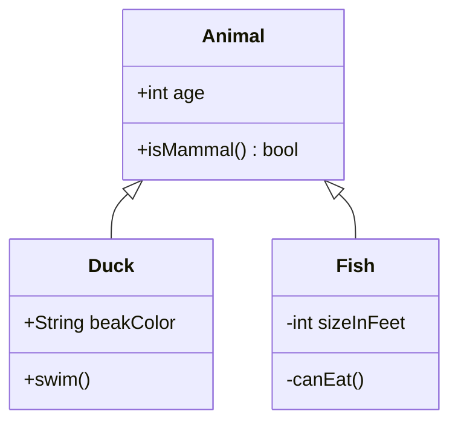

# 类图



## 头部

`classDiagram`（或 `classDiagram-v2`）。单独一行的 `direction TB|BT|LR|RL`
设置方向（默认从上到下）。

## 类

| 语法 | 含义 |
|---|---|
| `class Animal` | 一个类 |
| `class Square~T~` | 泛型类，显示为 `Square<T>` |
| `class Animal["Animal with a label"]` | 带显示名称的类 |
| `class Shape <<interface>>` | 带标注的类 |
| `class Animal:::name` | 类获得样式类 `name` |
| `class Duck {` … `}` | 带成员体的类 |

id 由字母（任意文字）、数字和 `_` 组成，中间可用 `-` 连接。第一个提到某个类的关系也会
创建该类。

## 成员

在类体内每行一个成员；在类体外写作 `Class : member`：

```
class BankAccount {
    +String owner
    +BigDecimal balance$
    +deposit(amount) bool
    +withdraw(amount)* int
}
BankAccount : -List~Transaction~ history
```

带括号的成员是方法，其余都是属性。

- **可见性**：首字符 `+`（public）、`-`（private）、`#`（protected）或
  `~`（package）保留在成员前面。
- **返回类型**：`)` 之后的文本——`+isMammal() bool` 显示为 `+isMammal() : bool`。
- **分类符**：末尾（或紧跟 `)`）的 `$` 表示静态成员，带下划线绘制；`*` 表示抽象成员，
  以斜体绘制。
- **泛型**：`List~int~` 显示为 `List<int>`，嵌套的也一样：
  `Map~String, List~int~~` → `Map<String, List<int>>`。

属性放在第一栏，方法放在第二栏。完全没有成员的类只绘制其名称。

## 标注

```
class Shape {
    <<interface>>
}
<<enumeration>> Color
class Service <<service>>
```

`<<` 与 `>>` 之间的任意单词——`interface`、`abstract`、`enumeration`、`service`
等——显示在类名上方，形如 `«interface»`。

## 关系

`A <|-- B`、`A --> B : label`、`A "1" *-- "many" B : owns`。

| 语法 | 关系 | 绘制为 |
|---|---|---|
| `<\|--` | 继承 | 空心三角形 |
| `*--` | 组合 | 实心菱形 |
| `o--` | 聚合 | 空心菱形 |
| `<--` | 关联 | 开放箭头 |
| `--` | 链接 | 实线 |
| `<\|..` | 实现 | 空心三角形，虚线 |
| `<..` | 依赖 | 开放箭头，虚线 |
| `..` | 虚线链接 | 虚线 |

箭头可以在任一端，也可以两端都有：`B --|> A`、`A *--o B`、`A <|--|> B`。标签写在
`:` 之后；基数是写在其类旁边的带引号字符串：`Customer "1" --> "*" Ticket`。类可以与
自身建立关系；这种关系绘制为类旁边的一个环。

布局把关系的“整体”一端放在前面——继承中的基类、组合或聚合中的容器——因此无论箭头
朝哪个方向书写，层次结构都自上而下阅读。

## 命名空间

```
namespace Shapes.Base {
    class Triangle
    class Rectangle {
        double width
    }
}
```

命名空间把类声明归入一个带标题的框中。与 Mermaid 相同，其中只能写 `class` 声明和
标注；关系、注解和 `Class : member` 行写在块之后。命名空间不能嵌套——用带点的名称
（`A.B`）表示层次。

## 注解

```
note for Duck "can fly\nand swim"
note "a note on its own"
```

`\n` 表示换行。给某个类的注解用虚线与该类相连；不带 `for` 的注解独立放置。

## 样式与链接

- `classDef name fill:…,stroke:…`、`cssClass "A,B" name`、`class A:::name` 和
  `style A …` 的用法与[流程图](flowchart.md#样式与类)相同，校验的属性也相同。填充色
  只作用于标题栏；成员栏保持自己的背景。
- `link A "url" "tooltip"` 和 `click A href "url" "tooltip" _blank` 把类变为链接——
  协议过滤与流程图相同。
- `callback A "fn"` 和 `click A call fn()` 会被接受并忽略：图表文本中的脚本永远不会
  执行。

## 注释

`%%` 开始一条注释，可单独成行，也可写在语句之后。

## 不支持

- 棒棒糖接口（`()--`、`--()`）。
- 反引号中的类名（`` class `Animal Class!` ``）——请使用标签：
  `class Animal["Animal Class!"]`。
- 关系语句中的泛型参数（`A~T~ <|-- B`）——用 `class A~T~` 声明泛型，并以 `A`
  引用该类。
- 嵌套命名空间。
- Front matter（`---` … `---`）和 `title`。
