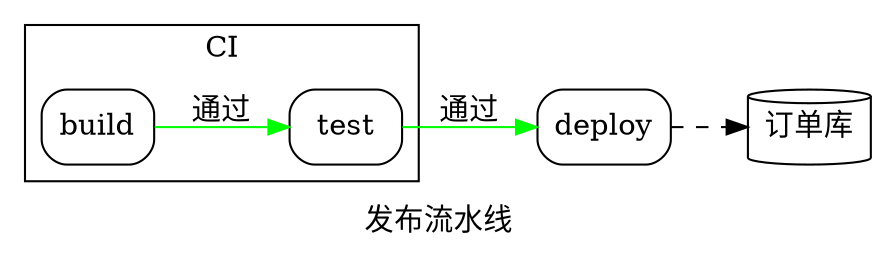

# Graphviz DOT

以 `digraph` 开头，或以 `graph` 加花括号主体开头的源码是 DOT（Mermaid 的 `graph TD` 没有花括号）。也可显式指定：`render(source, { syntax: 'dot' })`。DOT 使用流程图的布局绘制，而非 Graphviz，因此同一张图在这里看起来像流程图。

| 语法 | |
|---|---|
| `graph` / `digraph`、`strict` | 无向（`--`）或有向（`->`） |
| `a`、`a [label="…", shape=box]` | 节点及其属性 |
| `a -> b -> c [label="…"]`、`a -> {b c}` | 边链，可一次连到多个节点 |
| `node [ … ]`、`edge [ … ]`、`graph [ … ]` | 后续内容的默认值，按子图生效 |
| `rankdir=LR`、`label="…"` | 方向（`TB`、`LR`、`BT`、`RL`）和标题 |
| `subgraph cluster_x { label="…"; … }` | 带框的簇；不以 `cluster` 开头的子图只分组 |
| `a:port` | 接受端口 |
| `;`、换行、`//`、`/* */`、`#` | 分隔符和注释 |

**属性。** 节点：`label`（记录 `{a|b}` 变为多行；HTML 标签 `<…>` 去掉标记；`\n`、`\l`、`\r` 换行）、`shape`（box、rect、ellipse、oval、circle、point、doublecircle、diamond、hexagon、parallelogram、trapezium、invtrapezium、cylinder、note、folder、tab、component、box3d、plaintext、record、Mrecord 等）、`style`（rounded、filled、dashed、dotted、invis）、`color`、`fillcolor`、`fontcolor`。边：`label`、`style`（dashed、dotted、bold、invis）、`color`、`penwidth`、`dir`（forward、back、both、none）、`arrowhead` 和 `arrowtail`（normal、vee、empty、diamond、odiamond、dot、none、tee 等）、`minlen`。簇：`label`、`bgcolor`、`color`。颜色为名称或 `#rrggbb`，其他忽略。Graphviz 的布局属性（`pos`、`rank`、`constraint`、`splines` 等）被接受但不起作用。
