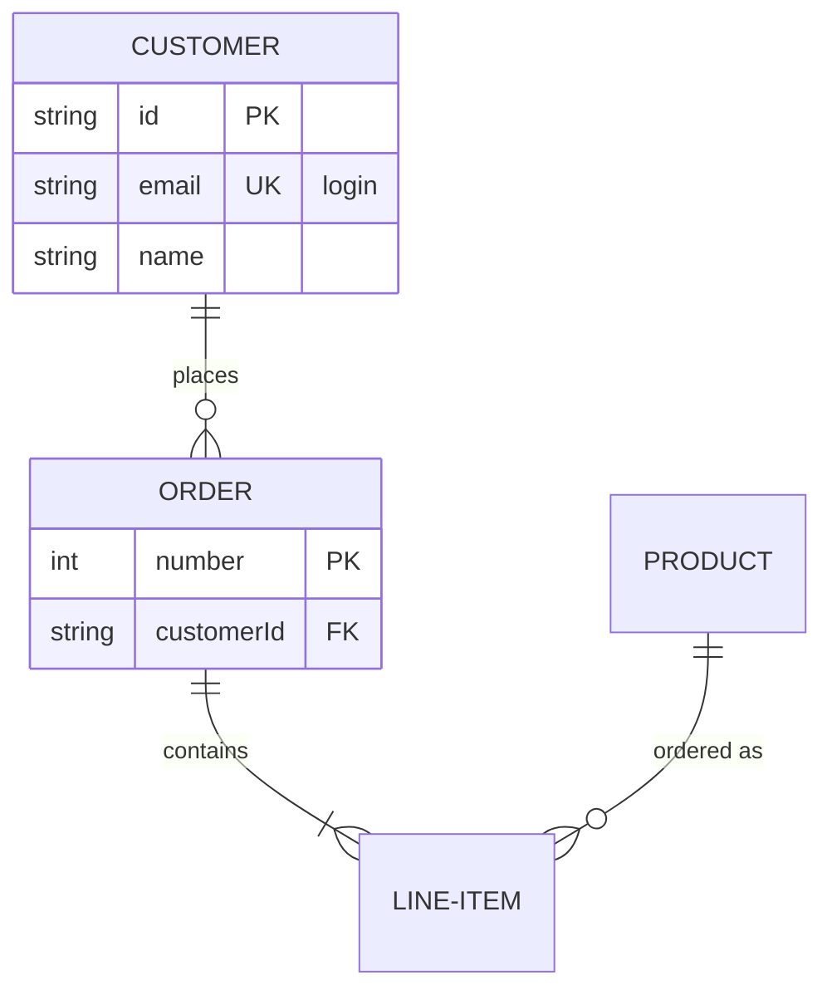

# 实体关系图



## 头部

`erDiagram`。单独一行的 `direction TB|BT|LR|RL` 设置方向（默认从上到下）。

## 实体

| 语法 | 含义 |
|---|---|
| `CUSTOMER` | 以其 id 命名的实体 |
| `LINE-ITEM` | id 由字母（任意文字）、数字和 `_` 组成，中间可用 `-` 连接 |
| `"Order line"` | 双引号中的任意名称，可包含空格 |
| `p["Person"]` 或 `p[Person]` | 别名：方框显示 “Person”，关系中使用 `p` |
| `CUSTOMER:::name` | 实体获得类 `name`（见[样式](#样式)） |

实体由第一个提到它的语句创建；一条关系就足够了。

## 属性

```
CUSTOMER {
    string id PK "the key"
    string email UK
    int orderNumber PK, FK
    decimal(10,2) total
    string[] tags
}
```

在 `{` … `}` 内每行一个属性：类型、名称，之后可选键和注释。

- **类型**：以字母、`_` 或 `*` 开头；可包含 `[]`、`()`、`,` 和 `-`——
  `decimal(10,2)`、`string[]`。
- **名称**：一个单词；可以以 `*` 开头。
- **键**：`PK`、`FK`、`UK`，多个时用逗号分隔。
- **注释**：双引号中的文本。

实体绘制为表格：名称位于标题栏，下面每个属性一行，类型、名称、键和注释按列对齐。没有
属性的实体只显示其名称。`CUSTOMER {}` 声明一个空实体。

## 关系

```
CUSTOMER ||--o{ ORDER : places
CUSTOMER }|..|{ ADDRESS : "ships to"
```

关系由第一个实体、基数、连线、基数、第二个实体组成，之后可选 `:` 加标签（可带引号，
也可不带）。

| 左侧 | 右侧 | 基数 |
|---|---|---|
| `\|\|` | `\|\|` | 恰好一个 |
| `\|o` | `o\|` | 零个或一个 |
| `}\|` | `\|{` | 一个或多个 |
| `}o` | `o{` | 零个或多个 |

| 连线 | 含义 |
|---|---|
| `--` | 标识关系：实线 |
| `..`（以及 `.-`、`-.`） | 非标识关系：虚线 |

每一端都在连线与实体相接处以鸦爪符号绘制。实体可以与自身建立关系；这种关系绘制为
实体旁边的一个环。

**文字形式。** Mermaid 用文字书写的基数同样可用，用 `to`（标识）或 `optionally to`
（非标识）代替连线：

```
CAR 1 to zero or more NAMED-DRIVER : allows
PERSON only one optionally to one or many ADDRESS : has
```

| 文字 | 基数 |
|---|---|
| `only one`、`1` | 恰好一个 |
| `zero or one`、`one or zero` | 零个或一个 |
| `one or more`、`one or many`、`many(1)`、`1+` | 一个或多个 |
| `zero or more`、`zero or many`、`many(0)`、`0+` | 零个或多个 |

## 样式

`classDef name fill:…,stroke:…`、`class a,b name`、`ENTITY:::name` 和
`style id …` 的用法与[流程图](flowchart.md#样式与类)相同，校验的属性也相同。对于有
属性的实体，填充色只作用于标题栏；各行保持自己的背景，使其文字在深色主题中依然清晰。

## 注释

`%%` 开始一条注释，可单独成行，也可写在语句之后。

## 不支持

- 写在左花括号 `{` 同一行上的属性，或一行中的多个属性。
- 在关系语句中给实体加类（`:::`）——请写在声明上。
- Front matter（`---` … `---`）和 `title`。
