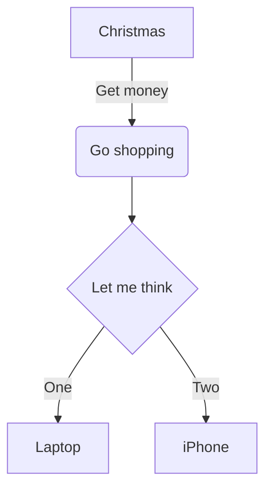
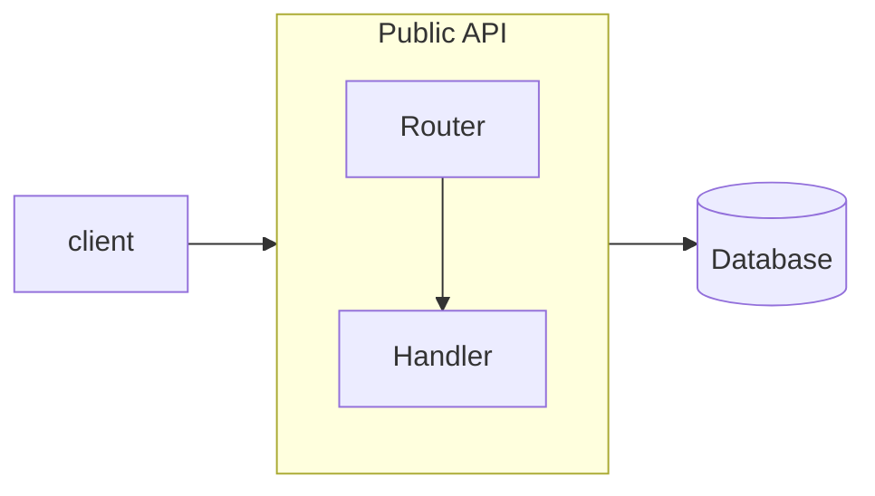

# 流程图



## 头部与方向

`flowchart` 或 `graph`，后跟方向：`TB`（或 `TD`，从上到下——默认）、`BT`、`LR`、
`RL`。

## 节点

节点是一个 id，后面可以跟上包在某种形状中的文本：

| 语法 | 形状 |
|---|---|
| `id` | 以 id 为文本的矩形 |
| `id[text]` | 矩形 |
| `id(text)` | 圆角矩形 |
| `id([text])` | 体育场形 |
| `id[[text]]` | 子程序 |
| `id[(text)]` | 圆柱（数据库） |
| `id((text))` | 圆 |
| `id(((text)))` | 双圆 |
| `id>text]` | 不对称形 |
| `id{text}` | 菱形（判断） |
| `id{{text}}` | 六边形 |
| `id[/text/]` | 平行四边形 |
| `id[\text\]` | 反向平行四边形 |
| `id[/text\]` | 梯形 |
| `id[\text/]` | 倒梯形 |

id 由字母（任意文字）、数字、`_`、`.`、`$` 以及字母之间的 `-` 组成。

**文本。** 将文本放在双引号中，即可在其中使用括号或其他特殊字符：`A["a (b) [c]"]`。
`<br>` 用于换行——这是唯一能识别的 HTML；其他标记都按文本显示。Mermaid 的实体代码
可用：`#quot;`、`#35;`、`#x23;`。

**Markdown 字符串。** 引号内反引号包裹的文本，如
``A["`**bold** and *italic*`"]``，支持 `**bold**` 和 `*italic*` /
`_italic_`、真实换行，并在 200 像素处自动折行。

## 边

| 语法 | 边 |
|---|---|
| `A --> B` | 箭头 |
| `A --- B` | 无箭头的线 |
| `A -.-> B` / `A -.- B` | 点线 |
| `A ==> B` / `A === B` | 粗线 |
| `A --o B` | 圆形端点 |
| `A --x B` | 叉形端点 |
| `A <--> B`、`A o--o B`、`A x--x B` | 两端都有端点 |
| `A ~~~ B` | 不可见：影响布局，但不绘制 |

**长度。** 多加的笔画让边跨越更多层级：`-->` 跨一层，`--->` 两层，`---->` 三层；
`-..->` 和 `===>` 同理。

**边上的文本。** `A -->|text| B`、`A -- text --> B`、`A -. text .-> B`、
`A == text ==> B`。引号和 Markdown 字符串的用法与节点相同。

**链与组。** `A --> B --> C` 是两条边。`A & B --> C & D` 是四条。

## 子图



- `subgraph id`、`subgraph id [title]`、`subgraph "title"` 或
  `subgraph title with spaces`（此时 id 为把空格换成 `_` 的标题）；以 `end` 结束。
  子图可以嵌套。
- 节点属于第一个提到它的子图。之后在顶层再次提到它，也不会把它移出。
- 边可以通过 id 指向子图；它们终止于子图的边框。
- 子图内的 `direction` 设置该子图自己的方向。与 Mermaid 一样，只有当子图内没有节点
  与子图外的节点相连时才生效（连到子图本身的边没有影响）。这样的子图会单独布局，并作为
  一个整体放置；边框被边穿过的子图则与图表其余部分一起布局。

## 样式与类

```
classDef warn fill:#fde68a,stroke:#b45309,color:#78350f
classDef default stroke-width:2px
A:::warn --> B
class B,C warn
style D fill:#bbf7d0,stroke:#15803d
linkStyle 0 stroke:#dc2626,stroke-width:2px
linkStyle default stroke-dasharray:4 2
```

`classDef default` 作用于所有节点。`linkStyle` 按边的书写顺序从 0 开始计数。

只接受下列属性，且取值经过校验——样式永远无法加载 URL，也无法影响图表之外的内容：

| 属性 | 取值 |
|---|---|
| `fill`、`stroke`、`color` | `#rgb`、`#rgba`、`#rrggbb`、`#rrggbbaa`、`rgb()`、`rgba()`、`hsl()`、`hsla()`、颜色名 |
| `stroke-width`、`font-size` | 数字，可带 `px` 或 `em` |
| `stroke-dasharray` | 数字 |
| `opacity`、`fill-opacity`、`stroke-opacity` | 0 到 1 |
| `font-weight` | `normal`、`bold`、`100`–`900` |
| `font-style` | `normal`、`italic` |

其他任何属性都会产生指明该属性的 `DiagramError`。

## 链接

```
click A href "https://example.com" "Tooltip" _blank
click B "/docs/page"
```

节点会变成链接。允许：`http:`、`https:`、`mailto:`、相对地址和锚点；其他任何协议
（`javascript:`、`data:` 等）都是错误。`_blank` 会添加 `rel="noopener noreferrer"`。
`click id callback`——调用 JavaScript 函数——会被忽略：图表文本中的任何内容都不会被执行。

## 注释

`%%` 开始一条到行尾的注释。`%%{init: …}%%` 指令会被跳过。

## 不支持

- `A@{ shape: …, label: … }` 节点语法（Mermaid 11）——报错；请使用括号形状。
- 边 id（`A e1@--> B`）和边动画。
- Font Awesome 图标（`fa:fa-car` 按文本显示）。
- `click` 回调（被忽略，见上文）。
- 标签中除 `<br>` 以外的 HTML（按文本显示）。
