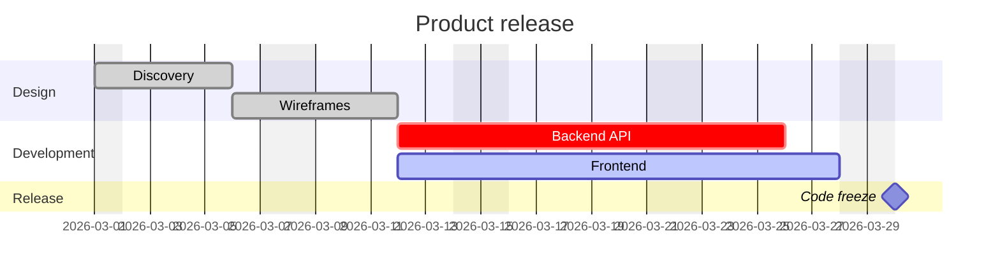

# 甘特图



## 设置

设置无论出现在何处，都作用于整张图表。

| 设置 | 含义 |
|---|---|
| `title …` | 图表上方的标题 |
| `dateFormat …` | 任务中日期的书写格式（默认 `YYYY-MM-DD`） |
| `axisFormat …` | 坐标轴上日期的显示格式（strftime） |
| `tickInterval 1day` | 坐标轴步长：一个数字加 `millisecond`、`second`、`minute`、`hour`、`day`、`week` 或 `month` |
| `excludes …` | 不计入的日子：`weekends`、星期名称、日期——以逗号或空格分隔 |
| `includes …` | 即使被排除也要计入的日期 |
| `weekend friday` / `weekend saturday` | `weekends` 指哪两天（默认周六和周日） |
| `inclusiveEndDates` | 结束日期包含当天 |
| `todayMarker off` | 见下文“今天” |
| `topAxis` | 顶部也显示坐标轴 |
| `section …` | 开始一组任务 |

**`dateFormat` 标记：** `YYYY`、`YY`、`MM`、`M`、`DD`、`D`、`HH`、`H`、
`mm`、`m`、`ss`、`s`、`SSS`、`X`（Unix 秒）、`x`（Unix 毫秒），以及方括号中的字面
文本（`[brackets]`）。表示名称的标记——月份和星期名称、序数词、AM/PM、时区——会报错，而
不是去猜测。日期按 UTC 读取，因此图表不依赖读者的时区；与格式不符的日期是错误（Mermaid
此时会退回到浏览器的日期解析器，而它依赖时区）。

**`axisFormat` 指令：** `%Y %y %m %d %e %j %b %B %a %A %u %w %H %I %M
%S %L %p %%`。未设置 `axisFormat` 时，格式随刻度步长而定：小于一天的步长显示小时和分钟，
按月的步长显示月份和年份，其他情况显示日期。

## 任务

```
Task name : [tags,] [id,] [start,] end-or-duration
```

- **标签**，可任意组合：`done`、`active`、`crit`、`milestone`。
- **Id**：一个不含空格的词，供 `after` 引用。
- **开始**：`dateFormat` 格式的日期，或 `after id1 id2 …`——这些任务中最晚的结束时间
  （它们可以在源文本后面定义）。没有开始时间的任务在前一个任务结束时开始；第一个任务必须
  有开始时间。
- **结束**：日期、`until id`（那个任务开始时），或持续时间：数字加 `ms`、`s`、`m`、
  `h`、`d`、`w`（例如 `3d`、`1.5h`、`2w`）。

以持续时间给出的任务会跨越被排除的日子而延长，与 Mermaid 相同；给出结束日期的任务在该日期
结束。里程碑在其开始处绘制为菱形。

没有 id 的任务按其在图表中的位置获得 `task1`、`task2`……

## 链接

`click id href "https://…"` 使任务成为链接（仅限 `http(s)`、`mailto`、相对地址）。

## 今天

表示当前日期的线会让输出依赖于时钟，因此 `render` 只在被要求时才绘制它，并使用指定的
日期：

```ts
render(source, { today: new Date() })
```

当该日期落在图表范围内时，这条线才会出现。源文本中的 `todayMarker off` 即使在这种情况下
也会将其关闭。

## 不支持

- `displayMode compact`——每个任务都占一行。
- `click id call …`——图表文本中的任何内容都不会被执行。
- `vert` 标记。
- 表示名称的 `dateFormat` 标记，strftime 的 `%U %W %Z %q`。
