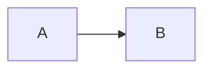

# 快速上手

## 安装

```bash
npm install @dskripchenko/diagrams
```

本包是一个 ES 模块，附带 CommonJS 构建和自带的类型定义，没有任何依赖。

## 渲染图表

```ts
import { render } from '@dskripchenko/diagrams'

const result = render(`sequenceDiagram
  Alice->>Bob: Hello
  Bob-->>Alice: Hi`)

result.svg     // '<svg xmlns="http://www.w3.org/2000/svg" …>…</svg>'
result.width   // natural size in pixels
result.height
result.type    // 'sequence'
```

SVG 自带 `width`、`height` 和 `viewBox`，以及样式
`max-width:100%;height:auto`，因此在窄容器中会缩小，但永远不会超过其自然尺寸。
将其作为标记插入页面：

```ts
container.innerHTML = result.svg
```

类型由第一行决定：`flowchart` 或 `graph`、`sequenceDiagram`、
`stateDiagram-v2`（或 `stateDiagram`）、`pie`、`gantt`。

## 选项

```ts
render(source, {
  measureText,  // how text is measured — see below
  idPrefix,     // prefix for ids inside the SVG
  title,        // accessible title
  today,        // gantt: draw a "today" line at this date
})
```

**`idPrefix`。** SVG 内的每个 id——根元素、箭头标记、作用域样式表——都以此前缀开头。
默认值是源文本的哈希，因此同一张图表始终得到相同的 id。当**同一张**图表在一个页面上
显示两次时，请为每个副本指定各自的前缀。

**`title`。** SVG 带有 `role="img"` 和供屏幕阅读器使用的 `<title>`。标题依次取自
此选项、源文本中的 `accTitle:`、图表自身的标题、图表类型。`accDescr:` 会成为
`<desc>`。

## 文本测量

布局取决于每个标签的宽度，而宽度又取决于读者浏览器所用的字体。因此测量是一个可以替换的
函数：

- **在浏览器中**，默认使用 canvas（可用时为 `OffscreenCanvas`）测量，字体栈与 SVG
  所请求的相同。
- **没有 DOM 时**——服务端渲染、Node 脚本、测试——默认使用 `approximateMeasurer`：
  一张涵盖拉丁字母、西里尔字母、数字和标点的字形宽度表，CJK 字符按全角计算。图形会留出
  内边距，以免微小误差导致文本溢出。

```ts
import { render, approximateMeasurer } from '@dskripchenko/diagrams'

// Identical output in every environment: use this for snapshots and caches.
render(source, { measureText: approximateMeasurer })
```

自定义测量函数接收文本和字体（`size`、`family`、`weight`、`style`），并以像素为单位
返回 `{ width, height }`。

## 错误

无法解析的源文本会抛出 `DiagramError`：

```ts
import { render, DiagramError } from '@dskripchenko/diagrams'

try {
  render(source)
} catch (error) {
  if (error instanceof DiagramError) {
    error.line     // 1-based, 0 when the problem is the diagram as a whole
    error.column   // 1-based, 0 when unknown
    error.hint     // what to write instead, when there is an obvious answer
    error.message  // includes the position
  }
}
```

支持的语法是 Mermaid 语法的一个明确声明的子集，本文档按类型逐一列出。超出范围的内容
都会报出带位置的错误——绝不会生成一张悄悄遗漏了内容的图片。

## 其他函数

```ts
import { detect, parse } from '@dskripchenko/diagrams'

detect('pie\n "a" : 1')   // 'pie' — or null when the first line names no known type
parse(source)             // the parsed structure, without layout: for tools and tests
```

## 在 Markdown 渲染器中

常见的集成方式是围栏代码块：

````markdown

````

把代码块的文本交给 `render`，并用 SVG 替换代码；遇到 `DiagramError` 时，改为显示代码
和错误信息。配合 [`@dskripchenko/ui`](https://github.com/dskripchenko/ui) 使用时，
`UidMarkdown` 正好可以为此接收代码块渲染器：

```ts
import { render, DiagramError } from '@dskripchenko/diagrams'

const mermaid = (code: string) => {
  try {
    return { html: render(code).svg }
  } catch (error) {
    if (error instanceof DiagramError) return { error: error.message }
    throw error
  }
}
// <UidMarkdown :source="text" :block-renderers="{ mermaid }" />
```

SVG 可以安全地作为标记插入：其中的每一段文本都已由本包转义。

## 限制

流程图或状态图最多可包含 500 个节点和 2000 条边；超过后布局的运行时间将不再可预测，
渲染会抛出 `DiagramError` 并建议拆分图表。500 个节点的布局耗时远低于一秒。
