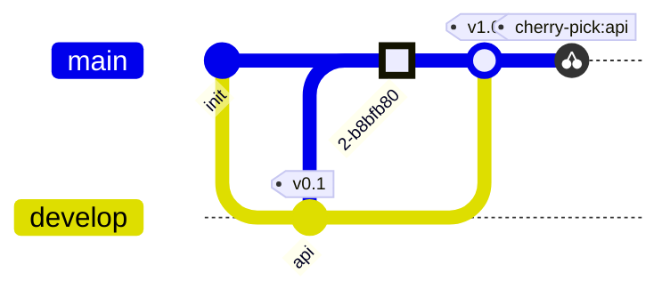

# Git 图

提交按书写顺序排列，每个分支一条泳道；`main` 一开始就存在。

| 语法 | |
|---|---|
| `gitGraph`、`gitGraph TB:`、`gitGraph BT:` | 从左到右、从上到下、从下到上 |
| `commit` | 当前分支上的提交 |
| `… id: "x" msg: "…" tag: "v1" type: NORMAL\|REVERSE\|HIGHLIGHT` | id（显示）、消息（没有 id 时显示）、标签、外观 |
| `branch 名称`、`… order: 2` | 从当前提交创建新分支并切换过去；`order` 决定泳道位置 |
| `checkout 名称`、`switch 名称` | 当前分支 |
| `merge 名称`，可带提交选项 | 有两个父提交的合并提交 |
| `cherry-pick id: "x"` | 在当前分支上复制提交 x |

错误：未知分支、没有新内容的合并、重复使用的提交 id。最多 500 个提交。
