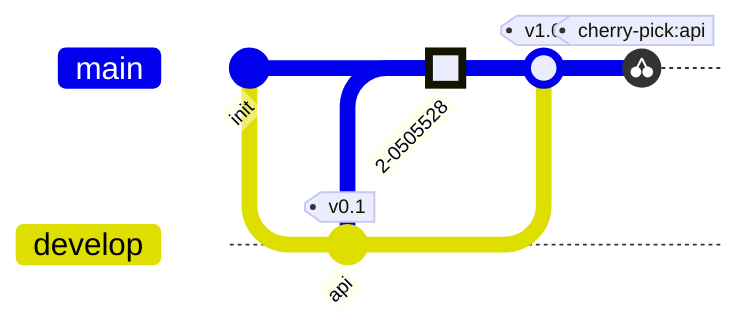

# Git 图



提交按书写顺序排列，每个分支一条泳道；`main` 一开始就存在。

| 语法 | |
|---|---|
| `gitGraph`、`gitGraph TB:`、`gitGraph BT:` | 从左到右、从上到下、从下到上 |
| `commit` | 当前分支上的提交 |
| `… id: "x" msg: "…" tag: "v1" type: NORMAL\|REVERSE\|HIGHLIGHT` | id（显示）、消息（没有 id 时显示）、标签、外观 |
| `branch 名称`、`… order: 2` | 从当前提交创建新分支并切换过去；`order` 决定泳道位置 |
| `checkout 名称`、`switch 名称` | 当前分支 |
| `merge 名称`，可带提交选项 | 有两个父提交的合并提交 |
| `cherry-pick id: "x"` | 在当前分支上复制提交 x |

错误：未知分支、没有新内容的合并、重复使用的提交 id。最多 500 个提交。

## 列表旁的提交图

对于真实的历史——从仓库读取、最新在前的提交——提交图是单独的一列，与宿主程序自己渲染的列表
（提交信息、作者、日期）逐行对齐：每条开发线一条轨道，每个提交一行，分叉与合并处画曲线。

```ts
import { renderCommitGraph } from '@dskripchenko/diagrams'

const { svg, width, graph } = renderCommitGraph(
  [
    { id: 'm', parents: ['b', 'f'] }, // 合并
    { id: 'f', parents: ['a'] },
    { id: 'b', parents: ['a'] },
    { id: 'a', parents: [] },
  ],
  { rowHeight: 28, head: 'm' },
)
```

第 *k* 行的中心位于 `k × rowHeight + rowHeight / 2`，因此这一列能与相同行高的列表并排对齐。
提交占用等待它的轨道；第一个父提交延续该轨道，其他父提交各自获得轨道；分支在其基线旁并行，
直到二者共同的提交处再弯回去。合并提交画成圆环，`head` 的圆点外加一圈，每条轨道保持调色板中的
一种颜色（`--dg-pie-1` … `--dg-pie-12`）。不在列表中的父提交（被截断的历史）会让其线条一直延伸到底部。

| 选项 | 默认值 | |
|---|---|---|
| `rowHeight` | 28 | 列表一行的高度 |
| `laneWidth` | 14 | 轨道之间的距离 |
| `radius` | 4 | 提交圆点的半径 |
| `head` | — | 当前检出的提交，会被标记 |
| `id` | `dg-commits` | `<svg>` 的 id，用于限定其样式 |
| `title` | Commit graph | 供辅助技术使用 |

结果包含 `width` 和 `height`、`graph`（布局：带轨道与颜色的行、线段），以及用于在旁边放置内容的
`laneX(lane)`。`layoutCommitGraph(commits)` 只返回布局，供自行绘制的宿主使用。
