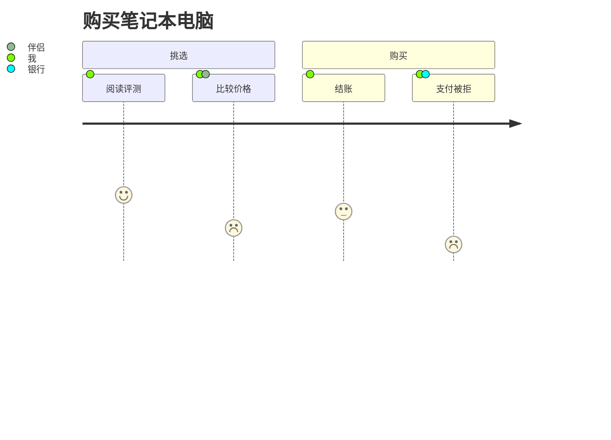

# 用户旅程

客户旅程地图：各步骤在所属分组下从左到右排列，每一步有 1（差）到 5（好）的评分，绘制为一张脸，评分越高位置越高；参与者以彩色圆点表示，图例中标出名称。

| 语法 | |
|---|---|
| `title …` | 标题 |
| `section …` | 开始一组步骤 |
| `步骤: 5: 参与者, 其他` | 步骤、评分（1–5）和参与者（可选） |

主题变量：`--dg-journey-face`、`--dg-journey-face-sad`（评分 1–2）、`--dg-journey-face-happy`（4–5）；分组颜色来自调色板（`--dg-pie-1` …）。
