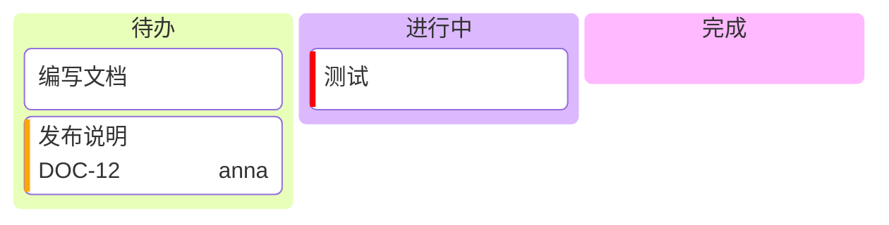

# 看板

| 语法 | |
|---|---|
| 外层缩进的 `id[标题]` | 一列 |
| 在列下缩进的 `id[文本]`、`[文本]` 或文本 | 一张卡片 |
| `@{ assigned: 'name', ticket: KEY-1, priority: 'High' }` | 卡片数据；优先级为 `Very High`、`High`、`Low` 或 `Very Low`（彩色条） |

各列并排，高度与最高的一列一致。
