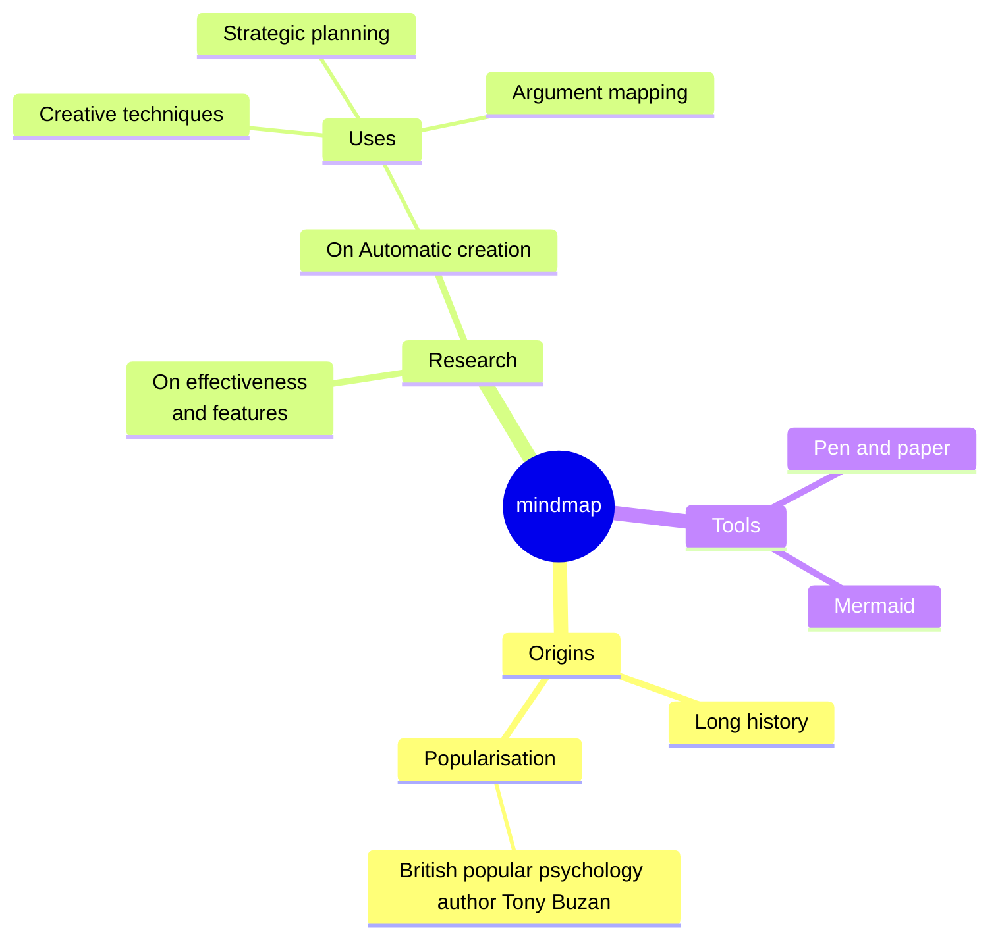

# 思维导图



第一行为 `mindmap`，然后是一份大纲：每行一个节点，用缩进表示嵌套。

## 结构

- **第一个节点是根节点。** 根节点只有一个：之后出现的、缩进不多于根节点的节点是错误，错误信息会指出根节点。
- 节点的**父节点**是它上方最近的、缩进更少的节点。缩进不必整齐——依次缩进 `4`、`6`、`5` 个空格也可以，与 Mermaid 相同。
  每个空白字符都算作一列，制表符也一样，所以不要混用制表符和空格。
- `%%` 开始注释。`accTitle:` / `accDescr:` 设置无障碍标题和描述。

## 节点形状

| 源码 | 形状 |
|---|---|
| `Text` | 默认：浅色块，下方有分支颜色的下划线 |
| `id[Text]` | 方形 |
| `id(Text)` | 圆角 |
| `id((Text))` | 圆形 |
| `id))Text((` | 爆炸形（bang） |
| `id)Text(` | 云形 |
| `id{{Text}}` | 六边形 |

- 形状前的 id 可以省略：`[Text]` 也可以。
- 没有形状的节点，其文字就是整行。与 Mermaid 一样，其中的括号会开始一个形状：`Pen (and) paper` 是错误
  （形状 `(` 没有在行尾闭合）。这样的文字要放在引号中：`id["Pen (and) paper"]`，默认形状则写 `"Pen (and) paper"`。
- 没有形状的根节点绘制为圆角块。

## 标签

- `<br>` 换行。宽于 200 像素的标签会自动换行。
- **Markdown 字符串**——``id["`text`"]``——支持 `**粗体**` 和 `*斜体*`，并且可以跨越多行源码；字符串中的每一行就是标签的一行：

  ```
  mindmap
      id1["`**Root** with
  a second line`"]
  ```

- 在 Markdown 字符串之外，`*` 和 `_` 是普通字符。

## 图标和类

节点下一行（或节点所在行末尾）的 `::icon(fa fa-book)` 以及 `:::类名` 会被接受并保存在解析得到的树中，但**不会绘制**：
图标需要图标字体，而 SVG 无法依赖它；Mermaid 的思维导图也没有能赋予类含义的 `classDef`。
因此，为 Mermaid 编写的图无需修改即可渲染，只是不显示图标。

## 布局

根节点位于中央。它的分支被分配到左右两侧，使两侧高度大致相同；阅读顺序为顺时针——前面的分支沿右侧向下，其余分支沿左侧向上。
每个分支以整齐的树形向外生长：子节点上下排列，每个父节点位于其子节点的中间。

布局是确定性的——没有力导向模拟，也没有随机性——因此同样的源码总是得到同样的图。
Mermaid 自己的布局不同（力导向布局），但结构相同。

每个第一层分支从 `--dg-pie-1` … `--dg-pie-12` 中取一种颜色，用于其节点（浅色调）和连接线（实色）；
根节点使用 `--dg-node-fill`、`--dg-node-stroke` 和 `--dg-node-text`。参见[主题](theming.md)。

一张思维导图最多可以有 500 个节点。
