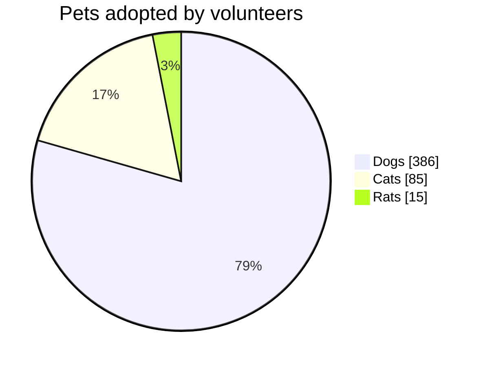

# 饼图

- `pie`，同一行可选地跟上 `showData` 和/或 `title …`。
- `title …` 和 `showData` 也可以各自单独成行。
- 每个扇区：一个用双引号（或单引号）括起的标签、一个冒号、一个数字。负数是错误；值为零的
  扇区会列在图例中，但不绘制。
- `accTitle:` / `accDescr:` 设置无障碍标题和描述。

扇区**按书写顺序**绘制，从十二点方向开始顺时针排列，因此图中的顺序与图例和源文本一致。
占比 3% 及以上的扇区内会显示百分比。`showData` 会在每个图例项后加上数值。

扇区颜色为 `--dg-pie-1` … `--dg-pie-12`（循环使用）；参见[主题](theming.md)。
