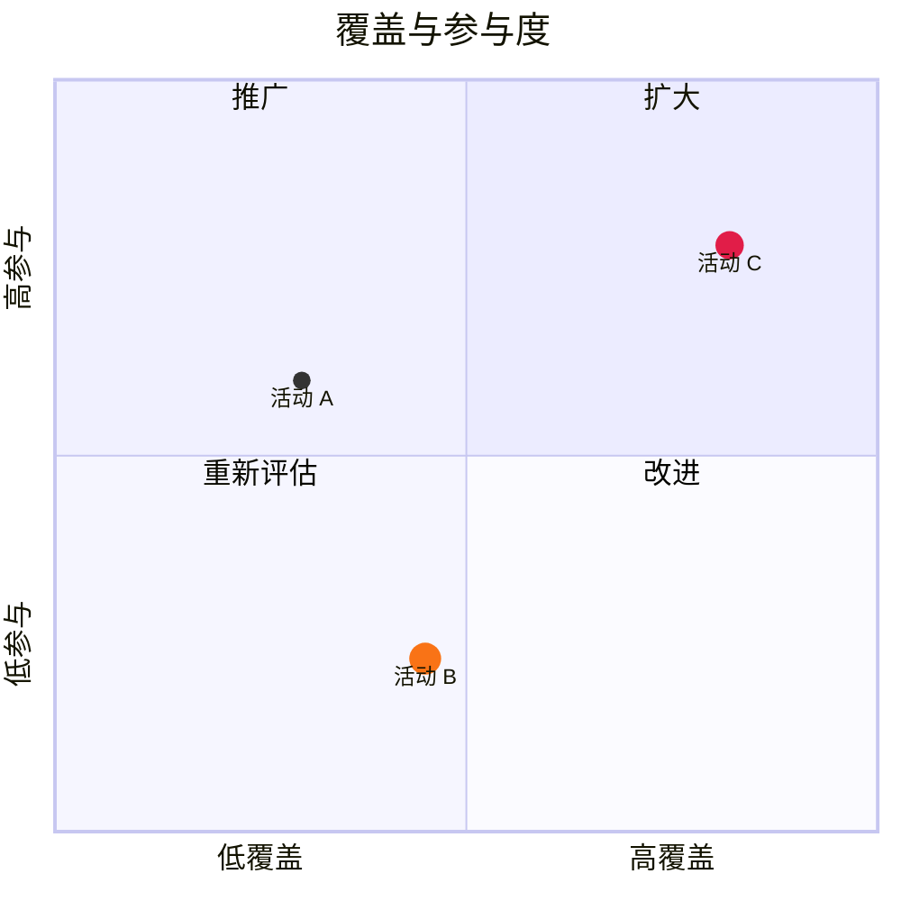

# 象限图

| 语法 | |
|---|---|
| `title …` | 标题 |
| `x-axis 低 --> 高`、`y-axis 低 --> 高` | 两端的坐标轴文字，或居中的一个 |
| `quadrant-1 …` … `quadrant-4 …` | 象限标签：1 右上，2 左上，3 左下，4 右下 |
| `名称: [x, y]` | 一个点，两个坐标都在 0 到 1 之间 |
| `… radius: 9, color: #f97316, stroke-color: #fff, stroke-width: 2px` | 点的样式 |
| `名称:::类: [x, y]`、`classDef 类 color: …, radius: …` | 共享样式 |

主题变量：`--dg-quadrant-1` … `--dg-quadrant-4`。
