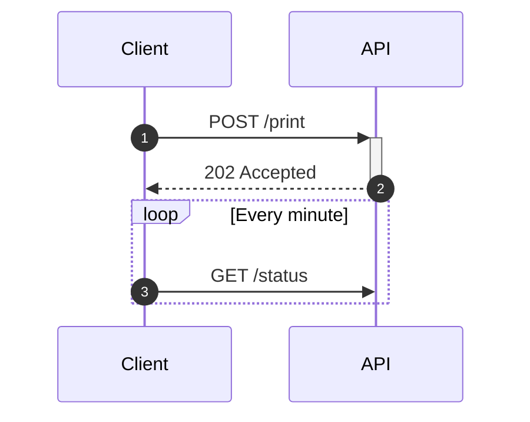

# 时序图



## 参与者

| 语法 | 含义 |
|---|---|
| `participant A` | 名为 `A` 的方框 |
| `participant A as Alice` | id 为 `A`，显示为“Alice” |
| `actor A` | 用小人图形代替方框 |
| （隐式） | 消息中用到的名称会成为参与者 |

参与者按声明或首次使用的顺序从左到右排列。`<br>` 用于标签换行。

**分组框**把参与者放在共同的背景下：

```
box Lavender Backend
    participant A as API
    participant W as Worker
end
```

颜色（名称、`#hex`、`rgb()` 等）和标签都是可选的。分组框内只能放参与者声明；分组框
不能嵌套。

**创建与销毁。** 在首次涉及 `B` 的消息之前写 `create participant B`，`B` 会画在该处
而不是顶部。`destroy B` 会在下一条涉及 `B` 的消息处以叉号结束 `B` 的生命线。

## 消息

`A->>B: text`。箭头：

| 箭头 | 线 | 端点 |
|---|---|---|
| `->` | 实线 | 无 |
| `-->` | 虚线 | 无 |
| `->>` | 实线 | 箭头 |
| `-->>` | 虚线 | 箭头 |
| `-x` | 实线 | 叉号 |
| `--x` | 虚线 | 叉号 |
| `-)` | 实线 | 开放箭头（异步） |
| `--)` | 虚线 | 开放箭头（异步） |
| `<<->>` | 实线 | 两端箭头 |
| `<<-->>` | 虚线 | 两端箭头 |

参与者发给自己的消息画成右侧的环。

**激活。** `A->>+B: text` 激活 `B`；`B-->>-A: text` 结束 `B` 的激活。
`activate B` 和 `deactivate B` 以单独的行实现同样效果。激活可以嵌套，并错开绘制。
停用一个未处于激活状态的参与者是错误。

**编号。** `autonumber` 为其后的消息编号；`autonumber 10`、`autonumber 10 5`
设置起始值和步长；`autonumber off` 停止编号。

## 注解

```
Note right of A: text
Note left of A: text
Note over A: text
Note over A,B: spans both
```

较长的注解会自动换行。

## 块

```
loop Every minute
    …
end

alt Success
    …
else Failure
    …
end

opt Optional
    …
end

par Alice to Bob
    …
and Alice to John
    …
end

critical Establish a connection
    …
option Timeout
    …
end

break When the request fails
    …
end

rect rgb(200, 220, 255)
    …
end
```

块可以嵌套。在所属块之外使用 `else`、`and` 和 `option` 是错误，没有可关闭块的
`end` 或未关闭的块同样是错误。`rect` 接受一个颜色，并在其消息后面绘制背景。

## 其他

`title …`、`accTitle:`、`accDescr:`、`%%` 注释。

## 不支持

- `participant A@{ … }` 元数据（Mermaid 11）——报错。
- `link`、`links`、`properties`、`details`——它们需要弹出菜单，而静态 SVG 没有。
- 块内的分组框或嵌套的分组框（Mermaid 同样不允许）。
