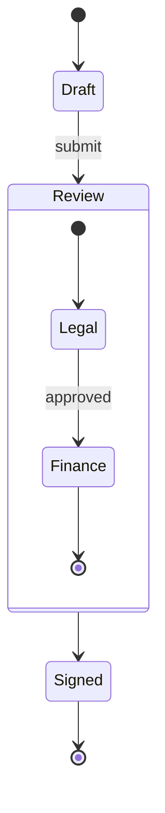

# 状态图



## 头部

`stateDiagram-v2` 或 `stateDiagram`——语法相同。单独一行的 `direction
TB|BT|LR|RL` 设置方向（默认从上到下）。

## 状态

| 语法 | 含义 |
|---|---|
| `Moving` | 以其 id 命名的状态 |
| `state "Long name" as s1` | 带显示名称的状态 |
| `s1 : description` | 一行描述；重复以添加更多行 |
| `state s1 : description` | 同上 |
| `[*]` | 起点（作为源）或终点（作为目标） |

带描述的状态绘制为：名称在上，一条分隔线，下方是描述行。

## 转换

`A --> B` 和 `A --> B : event`。`[*] --> A` 表示开始，`A --> [*]` 表示结束。

## 复合状态

```
state Review {
    [*] --> Legal
    Legal --> [*]
}
```

`state Name {` … `}`（或 `state "Title" as Name {`）用于嵌套状态；复合状态可以继续
嵌套。复合状态内的 `[*]` 是该复合状态自己的起点和终点。转换可以指向复合状态，并终止于
其边框。当复合状态内没有状态与外部状态相连时，其中的 `direction` 设置它自己的方向
（与 Mermaid 相同）。

**并发区域。** 在复合状态内单独一行的 `--` 将其拆分为多个区域，这些区域并排绘制，
带虚线边框：

```
state Active {
    [*] --> NumLockOff
    NumLockOff --> NumLockOn : press
    --
    [*] --> CapsLockOff
    CapsLockOff --> CapsLockOn : press
}
```

## 伪状态

```
state check <<choice>>
state split <<fork>>
state merge <<join>>
```

选择是一个小菱形；分叉与汇合是横跨流向的粗条。

## 注解

```
note right of Draft : Edited by the author
note left of Review
    Two lines
    of text
end note
```

在从上到下的布局中，注解位于状态的左侧或右侧；在从左到右的布局中——“左侧”会把注解放到
入向转换上——`left of` 将其放在上方，`right of` 放在下方。复合状态上的注解连接到其边框。

## 样式

`classDef`、`class a,b name`、`state:::name` 和 `style id …` 的用法与
[流程图](flowchart.md#样式与类)相同，校验的属性也相同。

## 不支持

- 状态上的 `click`。
- 状态名称中的 Markdown 字符串。
