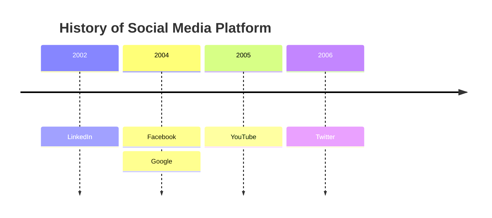
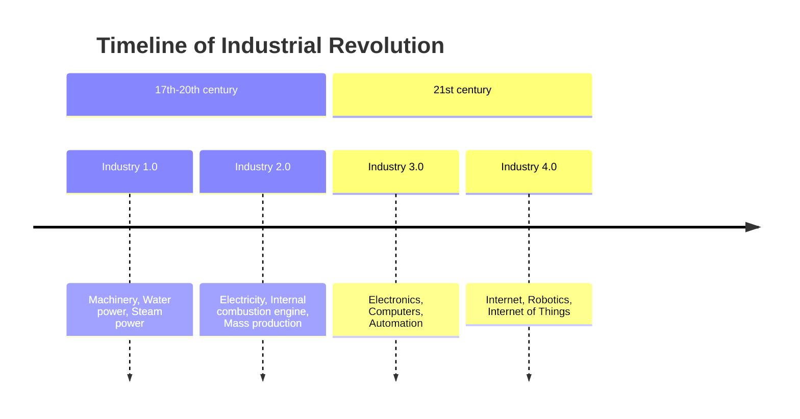

# 时间线

- 第一行为 `timeline`。`timeline LR` 被视为相同写法；`timeline TD`（竖向时间线）是错误。
- `title …` 在时间线上方放置标题。
- **时期**单独占一行：先写时期的文字，然后是它的事件，每个事件前写 `: `。
  `2004 : Facebook : Google` 是一个带两个事件的时期。时期也可以没有任何事件。
- **以 `:` 开头的行**会把事件添加到它上方的时期，因此长列表可以每行写一个事件。
- 分隔符是**后面跟着空格**（或位于行尾）的冒号。单词内部的冒号仍是文字：
  `10:30 : Stand-up at 10:30` 是时期 `10:30`，带有事件 `Stand-up at 10:30`。
- `section …` 开始一个分组：其后直到下一个分组之前的时期都属于它。写在第一个分组之前的时期不属于任何分组。
- 任何文字中都可以用 ` ` 换行；长文字按列宽自动换行。
- `%%` 开始注释。`accTitle:` / `accDescr:` 设置无障碍标题和描述。

空事件（`2024 : a :  : b`）、出现在任何时期之前的事件以及没有名称的分组都是错误，并给出行号和列号。

## 分组

每个分组是横跨其所有时期的标题。没有时期的分组仍会得到一列宽的标题，因此写下的内容不会丢失。

## 绘制

时期位于一条水平箭头上方，每个时期一列，按书写顺序从左到右排列；每个时期的事件堆叠在箭头下方，并用虚线与之相连。
列宽固定，因此无论文字长短，时期都能对齐。

颜色与 Mermaid 一致。**没有分组时**，每个时期有自己的颜色并以实色填充，其事件用同一颜色的浅色调。
**有分组时**，颜色属于分组：标题为实色，其中的时期和事件为浅色调。颜色依次取自 `--dg-pie-1` … `--dg-pie-12`，
实色块上的文字为 `--dg-pie-text`；参见[主题](theming.md)。

不支持：Mermaid 的 `disableMulticolor` 设置和竖向时间线。限制：最多 200 个时期和 1000 个事件。
