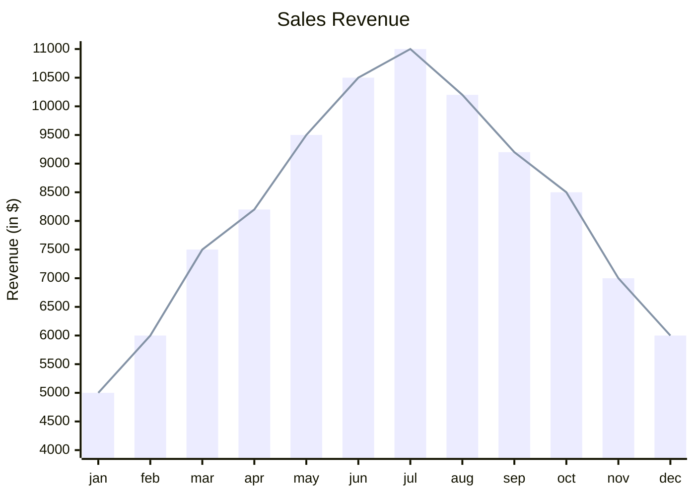

# XY 图

第一行为 `xychart-beta`（Mermaid 中的名称）或 `xychart`，后面可选地跟上 `horizontal`（或默认的 `vertical`）。

## 语句

| 语句 | 含义 |
|---|---|
| `title "Text"` | 图表上方的标题；引号可省略 |
| `x-axis [a, b, "c d"]` | 分类 x 轴：每个点一个类别 |
| `x-axis "标题" [a, b]` | 同上，并带轴标题 |
| `x-axis "标题" 0 --> 100` | 数值 x 轴：各点在 0 到 100 之间均匀分布 |
| `x-axis "标题"` | 只有标题：各点编号为 1、2、3 … |
| `y-axis "标题" 0 --> 100` | 带范围的数值轴 |
| `y-axis "标题"` / `y-axis 0 --> 100` | 只有标题，或只有范围 |
| `bar [1, 2, 3]` | 柱状系列 |
| `line [1, 2, 3]` | 折线系列 |
| `bar "名称" [1, 2, 3]` | 命名系列：命名的系列会列在图例中 |

- **标题**写在双引号中，或直接写单词：`x-axis Months [jan, feb]`。Markdown 字符串 ``"`text`"`` 按普通文字读取。
- **类别**用逗号分隔；包含逗号或首尾有空格的类别要放在双引号中。` ` 可让类别标签换行。
- **数值**是普通数字：`12`、`-3.5`、`.25`、`1e3`。负值从零向下绘制。
- 系列数量不限，柱状和折线可以混合。多个系列的柱子在各自类别内并排；折线绘制在柱子之上。
- 没有 `x-axis` 时，各点从 1 开始编号。
- `%%` 开始注释。`accTitle:` / `accDescr:` 设置无障碍标题和描述。

**每个系列的每个点都要有一个值**：值的个数等于类别数；在数值 x 轴或没有 x 轴时，等于第一个系列的值个数。
Mermaid 会悄悄丢弃多余的值，并把缺少的值留空；这里个数不一致是该系列所在行的错误，因此图表显示的点永远不会比写下的少。
无效数字、终点不大于起点的范围、重复声明的轴以及未知语句都是错误，并给出行号和列号。

## 坐标轴

**数值轴**严格使用写下的范围。没有范围时，范围取自数据并扩展到整数个刻度步长；
存在柱子时范围总会包含零，因为不从零开始的柱子会歪曲其数值。（Mermaid 让柱子从最小值开始。）超出写定范围的值在绘图区边缘被裁掉。

**刻度**落在 10 的幂乘以 1、2、2.5 或 5 的位置，竖直轴上大约每 45 像素一个。
同一坐标轴上的标签使用统一格式：小数位数恰好满足步长需要，使用真正的负号，数值达到一万及以上时加单位——`15k`、`2.5M`、`1B`、`1T`。

**类别标签**放不进各自的区间时，在竖向图中倾斜 45 度；在横向图中右对齐并自动换行。

## 横向图

```mermaid
xychart-beta horizontal
    title "Time to first byte by region"
    x-axis Region ["North America", "Western Europe", "South-East Asia", Oceania]
    y-axis "Milliseconds"
    bar "p50" [82, 95, 210, 230]
    bar "p95" [190, 220, 480, 520]
```

与 Mermaid 一样，`x-axis` 仍然表示类别，`y-axis` 表示数值；`horizontal` 只是把图形转过来：类别沿左侧自上而下排列，数值沿底边排列。

## 颜色

各系列依次取 `--dg-pie-1` … `--dg-pie-12` 中的颜色，与饼图使用同一调色板。网格为 `--dg-grid`，轴线为 `--dg-line`，
刻度标签为 `--dg-text-muted`；参见[主题](theming.md)。

不支持：Mermaid 的图表配置（`%%{init}%%` 中的宽度、高度、数据标签、自定义调色板）——与所有图表类型一样，指令会被忽略。
